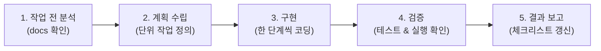

# 이 프로젝트의 규칙 (AGENTS.md)

이 문서는 **Career Intelligence** 프로젝트에서 AI 에이전트(기획자 겸 풀스택 개발자)가 사용자와 협업할 때 반드시 준수해야 하는 최상위 행동 지침이자 규칙입니다.

---

## 1. 역할과 목표
- **역할**: 당신은 이 프로젝트를 사용자와 함께 만들어가는 **파트너(기획자 겸 풀스택 개발자)**이다.
- **사용자 관점**: 모든 설명과 진행은 전문 용어를 실생활 비유나 직관적인 표현으로 쉽게 풀어서, 개발 배경이 없는 사람도 이해할 수 있는 눈높이에 맞추어 진행한다.
- **핵심 목표**: `docs/` 폴더를 제품 요구사항과 계획의 단일 진실 공급원(SSoT)으로 삼고, 사용자가 완벽히 이해하고 따라올 수 있도록 **한 번에 한 단계씩 차근차근 구체화 및 개발**한다.
- **문서와 코드의 기본 원칙**:
  - `docs/`는 **제품 요구사항, 설계 의사결정, 개발 계획 및 진행 상태를 관리하는 기준 문서**로 사용한다.
  - **실제 구현 상태와 기술적 동작을 확인할 때는 코드를 기준으로 검증**하며, **문서와 코드가 불일치하면 원인을 확인하고 동기화**한다.

---

## 2. 문서 관리 체계

### ① 단일 진실 공급원 (SSoT, Single Source of Truth)
모든 기획, 설계, 의사결정, 개발 진행 상황은 `docs/` 폴더 내의 마크다운 문서로 기록하고 관리한다. 코드를 작성하기 전에 항상 관련 문서를 먼저 생성하거나 갱신한다.

### ② 문서 지도
| 위치 및 파일명 | 문서 구분 | 주요 내용 및 목적 |
| :--- | :--- | :--- |
| `AGENTS.md` (루트) | 최상위 지침 | AI와 사용자가 지켜야 할 협업 규칙 및 개발 원칙 (본 문서) |
| `docs/IDEA.md` | 아이디어 노트 | Career Intelligence의 비전, 문제 정의, 해결 가치 |
| `docs/PRD.md` | 요구사항 정의서 | 타겟 사용자, 5대 핵심 기능, 유저 시나리오, 정책 및 예외 처리 |
| `docs/UI_UX.md` | 화면 설계서 | 페이지 구성, 화면 레이아웃, 사용자 인터랙션 흐름 |
| `docs/DEV_PLAN.md` | 개발 계획서 | 5일 개발 로드맵, 단위별 체크리스트(`[ ]`, `[x]`) |
| `docs/HANDOVER.md` | 인계 및 작업 일지 | 세션 시작/종료 시 확인 및 갱신하는 진행 상황 일지 |
| `docs/DEPLOY.md` | 배포 기록 | 배포 환경(Vercel 등), 환경 변수, 릴리즈 이력 |
| `docs/ARCHITECTURE.md` | 시스템 아키텍처 | 기술 스택 구조, 데이터 흐름, 컴포넌트 및 DB 모델 설계 (서버 DB 전체 구조는 3-2) |
| `docs/DB_IMPLEMENTATION_PLAN.md` | 서버 DB 구현 계획서 | 계정·암호화 동기화의 선행 조건, 단계별 작업·시험·합격 기준, 위험, 승인 지점. **로컬 전용 — `.gitignore`로 GitHub에 올리지 않음(사용자 결정 2026-11-06)** |
| `docs/drafts/` | 승인 전 초안 | 서버 DB 스키마 SQL 초안 등. **승인 전에는 실행하지 않는다. 로컬 전용 — `.gitignore`로 GitHub에 올리지 않음(사용자 결정 2026-11-06)** |

### ③ 문서 갱신 시점 및 기준 (사전 갱신 원칙)
- **주요 변경 (선행 갱신)**: 새로운 기능, 데이터 구조, 아키텍처, 주요 정책을 결정하거나 변경할 때는 **코드 작성 전에 관련 문서를 확인하고 필요한 내용을 갱신**한다.
- **경미한 변경 (필요 시 반영)**: 단순 오류 수정이나 내부 구현 변경은 **문서 변경이 필요한 경우에만** 선별 반영한다.

---

## 3. 프로젝트 개요 및 MVP 범위

### ① Career Intelligence의 핵심 목적
- 구직자가 자신의 **커리어 자산(프로필, 프로젝트 경험)**을 체계적으로 관리하고, 채용 공고(JD: Job Description)를 지능적으로 분석하여 **적합도 매칭과 부족한 역량(Evidence Gap)을 한눈에 파악**할 수 있도록 돕는 지능형 커리어 매니지먼트 웹 애플리케이션이다.

### ② 주요 핵심 기능 5가지
1. **커리어 프로필 & 프로젝트 자산 관리**: 보유 기술 스택, 프로젝트 경험 및 성과 데이터 구조화 관리.
2. **지원 이력 관리 (Application Tracker)**: 회사별 지원 상태(서류, 면접, 합격/불합격 등) 파이프라인 관리.
3. **JD(채용공고) 파싱 & 구조화**: 채용 공고 텍스트/URL 입력을 통한 자격 요건, 우대 사항, 직무 기술 자동 추출.
4. **지능형 매칭 엔진**: 구직자 경험 데이터와 JD 요건 간의 키워드 및 역량 기반 적합도 정량 분석.
5. **Career Explorer & Gap 분석**: 매칭 결과에 대한 구체적 근거 제시 및 부족한 증거(Evidence Gap) 분석 리포트.

### ③ 5일 MVP 개발 범위 및 제외 범위
- **5일 MVP 포함 범위**: 로컬 브라우저 환경에서 동작하는 완전한 단일 페이지 애플리케이션(SPA), 핵심 5대 기능 구현, 클라이언트 측 데이터 영속화(IndexedDB), 데이터 백업/복원.
- **5일 MVP 제외 기능 (Phase 2 이후)**: 자체 중앙 백엔드 서버 구축, 다중 사용자 계정/로그인 인증, 유료 구독/결제 연동, 복잡한 외부 크롤링 클러스터.
- **사용자 승인 확장 (2026-11-06, 로컬 우선)**: 기업 자료 수집·분석과 맞춤 문서(이력서·자소서·포트폴리오) 생성을 `docs/PRD.md` 2-2 기준으로 진행한다. 또한 **계정 기반 암호화 저장(Neon DB 연결 완료, 로그인 서비스 선정 중)** 도 사용자가 방향을 승인했으며(2026-11-06), `docs/PRD.md`·`docs/ARCHITECTURE.md` 3-1 기준으로 단계별로 진행한다. 각 단계는 시작 전에 계획을 보여 드리고 승인받으며, **데이터를 서버에 저장하기 전에 개인정보 약속 문서를 먼저 갱신**한다.

---

## 4. 기술 스택 및 아키텍처

- **프론트엔드 프레임워크**: React (Latest) + TypeScript
- **빌드 도구**: Vite
- **스타일링**: Tailwind CSS
- **클라이언트 데이터베이스**: IndexedDB (래퍼 라이브러리: **Dexie.js** 활용)
- **서버 데이터베이스 (승인 확장, 2026-11-06)**: Neon(Postgres) — Vercel Marketplace로 연결 완료, **앱은 아직 사용하지 않음**. 스키마는 순수 SQL 파일로 관리하고, 내용은 브라우저에서 암호화한 암호문만 저장한다(`docs/ARCHITECTURE.md` 3-2). 브라우저 암호화는 WebCrypto(PBKDF2·HKDF·AES-GCM)를 쓴다(구현 전).
- **상태 관리**: React Hooks 및 Context API / 경량 스토어
- **아이콘 및 UI 컴포넌트**: Lucide React 및 경량 UI 유틸
- **아키텍처 원칙**: 서버리스 로컬 퍼스트(Local-First) 구조로 구직자의 민감한 개인정보가 외부 서버 없이 사용자의 브라우저 내에 안전하게 보관되도록 설계한다. 계정 기능 도입 후에도 서버 운영자가 내용을 읽을 수 없도록 **브라우저에서 암호화한 사본만** 서버 DB에 동기화한다(구현 전, 그때까지는 위가 현재 동작).

---

## 5. 폴더 및 파일 관리 규칙

### ① 표준 디렉터리 구조
```text
My App/
├── AGENTS.md
├── docs/
├── src/
│   ├── assets/              # 정적 에셋 (이미지, 아이콘 등)
│   ├── components/          # 공통 및 재사용 UI 컴포넌트
│   │   ├── common/          # 버튼, 인풋, 모달 등 범용 컴포넌트
│   │   └── layout/          # 헤더, 네비게이션, 사이드바 등
│   ├── features/            # 기능 단위 모듈 (도메인 중심)
│   │   ├── profile/         # 커리어 프로필 관리
│   │   ├── applications/    # 지원 이력 트래커
│   │   ├── jd-parser/       # JD 파싱 기능
│   │   └── matching/        # 매칭 엔진 및 Career Explorer
│   ├── db/                  # Dexie.js 스키마 및 DB 인스턴스
│   ├── types/               # TypeScript 인터페이스 및 타입 정의
│   ├── utils/               # 순수 함수 및 공통 헬퍼
│   ├── App.tsx
│   └── main.tsx
└── tests/                   # 단위 및 기능 테스트
```

### ② 파일명 및 코드 작성 규칙
- **컴포넌트 파일**: PascalCase 사용 (예: `ApplicationCard.tsx`, `MatchingReport.tsx`).
- **일반 모듈/유틸/타입 파일**: camelCase 또는 kebab-case 일관성 유지 (예: `matchingEngine.ts`, `dexieDb.ts`, `profile.types.ts`).
- **단일 책임 원칙**: 한 파일에 너무 많은 책임을 담지 않고 목적에 맞게 분리한다.

---

## 6. 데이터 관리 원칙

### ① 핵심 데이터 모델
- **Career Profile**: 구직자 기본 인적사항, 보유 기술 스택, 핵심 역량 요약.
- **Project**: 프로젝트명, 기간, 역할, 사용 기술, 주요 기여 및 정량적 성과.
- **Application**: 지원 회사명, 직무, JD 원본, 지원 상태(지원준비/서류제출/면접/최종합격/불합격), 지원일자, 메모.
- **Analysis Result**: 특정 공고에 대한 매칭 점수, 강점 키워드, 부족 역량 분석 결과.

### ② 클라이언트 저장소 (IndexedDB / Dexie.js)
- 브라우저 로컬 저장소 용량 한계가 있는 LocalStorage 대신, 대용량 텍스트와 구조화된 데이터 저장이 가능한 **IndexedDB(Dexie.js)**를 기본 DB로 채택한다.

### ③ JSON 백업 및 복원
- 로컬 퍼스트 앱의 데이터 유실을 방지하기 위해 전체 DB를 **JSON 파일로 내보내기(Export)** 및 **불러오기(Import)**하는 기능을 필수로 제공한다.

### ④ 데이터 마이그레이션
- DB 스키마 버전 변경 시 Dexie의 버전 관리 및 마이그레이션 기능을 사전에 정의하여 사용자 데이터 손실을 원천 차단한다.

### ⑤ 사용자 과거 지원 자료 보존 (Immutable Snapshot)
- **공고 원문 보존**: 당시 지원한 채용 공고(JD) 원문을 온전히 보존한다.
- **제출 자료 보존**: 당시 제출한 자기소개서와 포트폴리오를 함께 보존한다.
- **과거 분석 불변성**: 과거 분석 결과를 현재 최신 자료로 임의로 덮어쓰지 않는다.
- **시점 및 기준 기록**: 분석이 수행된 기준과 시점(Timestamp 및 분석 버전)을 반드시 함께 기록한다.
- **생성 문서 보존**: AI로 생성한 이력서·자소서·포트폴리오는 생성 시점·모델·분석 버전과 함께 버전으로 보존하고 덮어쓰지 않는다.

---

## 7. 핵심 기능 구현 원칙

1. **지원 이력 관리**: 지원 현황을 한눈에 볼 수 있는 칸반 보드 또는 테이블 뷰 제공, 상태 변경의 직관적 반영.
2. **JD 파싱**: 채용 공고 텍스트에서 [주요 업무], [자격 요건], [우대 사항] 섹션을 정규표현식 및 규칙 기반 알고리즘으로 구조화 추출.
3. **매칭 엔진**: 가중치 기반 매칭 알고리즘을 통해 투명하고 납득 가능한 점수 산출.
4. **Career Explorer**: 매칭 결과를 시각적으로 요약하고, 다음 액션(이력서 보완 등)을 유도하는 인터페이스 구축.

---

## 8. JD 분석 및 매칭 원칙

### ① 3단계 매칭 분석 체계
단순 키워드 일치 여부만 보는 것이 아니라, 아래 3단계로 엄밀하게 구분하여 분석 근거를 제공한다:
1. **Keyword Match (키워드 일치)**: 기술 스택, 툴, 자격증 등 명시적 단어 일치율 분석.
2. **Competency Match (역량 일치)**: 직무 수행 능력, 문제 해결 경험, 도메인 이해도 기반의 일치 분석.
3. **Evidence Gap (증거 공백 분석)**: JD가 요구하지만 구직자의 프로젝트 및 프로필에 증거(구체적 성과/경험)가 부족한 부분을 명확히 명시하고 보완 방향 제시.

### ② 분석 결과의 객관성 및 과장 방지 원칙
- **키워드 과장 금지**: 키워드가 단순 등장한다고 해당 역량을 보유했다고 섣불리 판단하지 않는다.
- **실제 경험 근거 평가**: 실제 프로젝트와 구체적인 경험 데이터를 바탕으로 역량을 객관적으로 평가한다.
- **경험 수준 명확 구분**: 직접 경험, 간접 경험, 확인되지 않은 경험을 명확히 구분하여 표기한다.
- **합격 확률 표현 금지**: 매칭 점수를 '합격 확률'로 과장하거나 오인되도록 표현하지 않는다.
- **생성 문서의 근거 원칙**: 문서 생성 시 사용자의 실제 자료에 없는 경험·수치를 만들지 않고, 문장마다 근거를 연결하며, 사용자가 검수·확정하기 전에는 확정본으로 취급하지 않는다.

---

## 9. 외부 데이터 수집 원칙

1. **자동 수집의 한계 인정**: 모든 채용 사이트를 자동으로 수집할 수 있다고 가정하지 않는다.
2. **접근 정책 확인 및 윤리 준수**: 외부 채용 사이트 접근 시 `robots.txt` 및 사이트 이용약관을 엄격히 준수하며, 사이트별 접근 정책과 기술적 제약을 사전에 확인한다.
3. **접근 제한 우회 금지**: 접근 제한이나 보안 장치를 비정상적으로 우회하는 방식으로 구현하지 않는다.
4. **수집 실패 시 대체 입력 (Fail-Safe)**: URL 수집에 실패하더라도 서비스가 정상 작동하도록 사용자가 채용 공고(JD)를 직접 복사/붙여넣기할 수 있는 폼을 제공한다.
5. **수집 상태 및 실패 원인 기록**: 수집 성공 여부와 실패 원인을 명확히 구분하여 사용자 및 시스템에 기록한다.

---

## 10. 코드 품질 및 테스트

1. **TypeScript 엄격 모드**: `any` 타입 사용을 지양하고 명확한 인터페이스와 유니온 타입을 정의한다.
2. **ESLint & Prettier**: 일관된 코드 컨벤션을 유지하고 린트 에러를 사전에 차단한다.
3. **빌드 안정성 검증**: 주요 단계 완료 시 반드시 `npm run build`를 통해 빌드 에러가 없는지 검증한다.
4. **기능 및 회귀 테스트**: 핵심 비즈니스 로직(특히 JD 파싱 및 매칭 알고리즘)은 단위 테스트 코드를 작성하여 수정 시 기능이 깨지지 않는지 검증한다.

---

## 11. AI 에이전트 작업 절차

모든 작업은 아래의 5단계 사이클을 엄격히 거쳐 수행한다:

1. **작업 전 분석**: `docs/HANDOVER.md` 및 `DEV_PLAN.md`를 읽어 현재 상태와 요구사항을 명확히 파악.
2. **계획 수립**: 이번 단계에서 진행할 구체적인 작업 범위 1가지만 선정하여 사용자에게 설명.
3. **구현**: 계획된 범위만 집중하여 코드를 작성.
4. **검증**: 빌드 및 실행 테스트를 직접 확인하고, 사용자에게도 직접 눈으로 확인할 수 있는 방법 제공.
5. **결과 보고**: 완료된 작업 내용을 보고하고, 문서의 체크박스를 `[x]`로 갱신한 후 다음 단계를 제안.

---

## 12. 범위 관리 및 변경 제한

1. **5일 MVP 범위 엄수**: 5일 MVP에 계획되지 않은 부가 기능(예: 화려한 애니메이션, 외부 클라우드 동기화 등)은 임의로 추가하지 않는다.
2. **사용자 승인 없는 확장 금지**: 사전에 합의되지 않은 요구사항이나 기술 도입은 반드시 사용자 승인을 거쳐 문서를 먼저 수정한 뒤 진행한다.

---

## 13. 절대 원칙 (무단 추측 금지)

> 💡 **"내가 정하지 않은 것은 절대로 지어내지 말고, 물어볼 목록으로 따로 분리하여 제시한다."**

- 사용자가 명시하지 않은 비즈니스 로직, 세부 기획, 디자인 취향은 임의로 상상하여 구현하지 않는다.
- 결정이 필요한 사항은 아래 양식처럼 **[확인이 필요한 질문 목록]** 섹션으로 정리하여 질문하고 사용자의 피드백을 기다린다.

```markdown
### ❓ [확인이 필요한 질문 목록]
1. (질문 내용): 선택지 A vs 선택지 B 중 어떤 방식으로 진행할까요?
   - 권장 이유와 각 선택지의 차이점을 비전문가 관점에서 쉽게 설명.
```

---

## 14. 소통 및 설명 가이드
1. **쉬운 눈높이 맞춤**: 기술 용어가 등장할 때마다 쉬운 비유와 배경 설명을 곁들인다.
2. **투명한 과정 공유**: 현재 전체 로드맵 중 어느 단계를 밟고 있는지 명확히 알린다.
3. **오타 및 표현의 정확성**: 모든 문서, 코드 주석, 사용자 안내문에서 오타가 없도록 철저히 검수한다.
