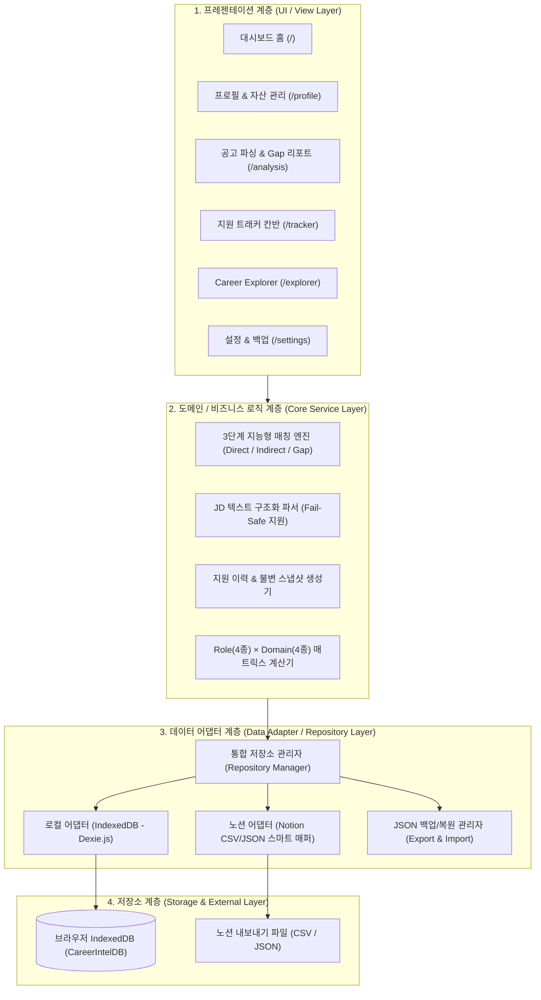

# 시스템 아키텍처 (ARCHITECTURE.md)

이 문서는 **Career Intelligence**의 시스템 구조, 4계층 아키텍처(Layered Architecture), 데이터 모델(스키마), 디렉터리 구성 및 기술적 설계 의사결정을 정의하는 기준 문서입니다.

---

## 1. 시스템 개요 (System Overview)

- **아키텍처 패턴**: **Local-First 4-Layer Architecture (로컬 퍼스트 4계층 아키텍처)**
- **핵심 설계 철학**:
  - **프라이버시 중심 (Privacy-First)**: 구직자의 민감한 이력서, 자소서, 프로젝트 정보가 외부 중앙 서버에 저장되지 않고 사용자 브라우저(IndexedDB)에 안전하게 격리 보관됩니다.
  - **어댑터 기반 확장성 (Adapter-Driven Extensibility)**: 로컬 저장소와 외부 데이터(예: 노션, 추후 링크드인 등)의 형식을 추상화하여, 새로운 데이터 소스가 추가되어도 UI나 매칭 로직이 영향을 받지 않는 구조를 유지합니다.
  - **불변 스냅샷 보존 (Immutable Snapshot)**: 지원 시점의 공고 원문과 제출 서류, 분석 결과는 최신 프로필 변경과 독립적으로 영구 보존됩니다.

---

## 2. 전체 시스템 구조도 (4-Layer Structure)



---

## 3. 데이터 모델 설계 (Data Models & TypeScript Interfaces)

### ① Profile (구직자 기본 프로필)
```typescript
export interface Profile {
  id: string; // 고유 ID (기본값: 'current-user')
  name: string; // 사용자 이름
  title: string; // 한 줄 소개 / 현재 직무
  targetRole: string; // 희망 직무 (예: AI Applied Engineer)
  targetDomains: string[]; // 관심 도메인 (예: ['소리 & 오디오', '미디어 & 생성형 AI'])
  skills: string[]; // 보유 기술 스택 태그 (예: ['PyTorch', 'FastAPI', 'Docker'])
  updatedAt: string; // 최근 수정 일시 (ISO String)
}
```

### ② Project (프로젝트 자산)
```typescript
export interface Project {
  id: string; // UUID
  title: string; // 프로젝트명
  period: {
    startDate: string; // 'YYYY-MM'
    endDate?: string; // 'YYYY-MM' (진행 중일 경우 undefined)
    isOngoing: boolean;
  };
  role: string; // 담당 역할
  techStack: string[]; // 사용 기술 스택 태그
  description: string; // 프로젝트 개요
  outcomes: string[]; // 정량적 성과 및 기여 내용 불릿 포인트
  links?: { title: string; url: string }[]; // 깃허브, 데모 링크
  createdAt: string;
  updatedAt: string;
}
```

### ③ JobDescription (채용 공고 구조화 모델)
```typescript
export interface JobDescription {
  id: string;
  company: string; // 기업명
  role: string; // 채용 직무
  domain: string; // 산업/기술 분야
  rawText: string; // 공고 원문 전체 (Fail-Safe 보존)
  sourceUrl?: string; // 공고 원본 URL
  sections: {
    responsibilities: string[]; // 주요 업무
    qualifications: string[]; // 자격 요건
    preferred: string[]; // 우대 사항
  };
  parsedAt: string;
}
```

### ④ AnalysisResult (3단계 지능형 매칭 & Gap 분석 결과)
```typescript
export interface MatchEvidence {
  requirement: string; // 공고의 요구사항 문장
  matchedSkillOrExperience: string; // 매칭된 기술 또는 프로젝트 성과
  projectId?: string; // 근거 프로젝트 ID
  description: string; // 구체적 매칭 근거 설명
}

export interface AnalysisResult {
  id: string;
  jdId: string;
  directMatches: MatchEvidence[]; // 🟢 직접 증명된 역량
  indirectMatches: MatchEvidence[]; // 🔵 간접 연결 경험
  evidenceGaps: {
    requirement: string;
    missingReason: string;
    actionGuide: string; // 자기소개서/포트폴리오 보완 가이드
  }[]; // 🟠 증거 공백
  summaryScore: number; // 종합 역량 충족도 점수 (과장 없는 객관적 지표, 0~100)
  analyzedAt: string;
}
```

### ⑤ Application (지원 이력 & 불변 스냅샷)
```typescript
export type ApplicationStatus = 'READY' | 'SUBMITTED' | 'INTERVIEW' | 'ACCEPTED' | 'REJECTED';

export interface Application {
  id: string;
  company: string;
  role: string;
  domain: string;
  status: ApplicationStatus;
  appliedDate?: string;
  notes?: string;

  // ★ 불변 스냅샷 (당시 지원 시점의 자료를 통째로 보존)
  snapshot: {
    jdSnapshot: JobDescription; // 당시 공고 원본
    resumeText: string; // 당시 제출한 자기소개서 전문
    portfolioUrl?: string; // 포트폴리오 링크
    analysisSnapshot: AnalysisResult; // 당시 매칭 분석 결과
    snapshotTimestamp: string; // 스냅샷 생성 일시
  };

  createdAt: string;
  updatedAt: string;
}
```

### ⑥ NotionMappingConfig & Schema Discovery (노션 동적 스키마 감지 및 매핑 모델)
```typescript
// 사용자 노션 DB의 속성 메타데이터 (동적 감지)
export interface NotionPropertyMeta {
  id: string;
  name: string; // 노션 컬럼 이름 (예: '과제명', 'Tech Stack', '진행기간')
  type: string; // 'title' | 'multi_select' | 'select' | 'rich_text' | 'date' | 'url' 등
}

// 스키마 스캔 결과 객체
export interface NotionSchemaDiscovery {
  databaseId: string;
  databaseTitle: string;
  properties: NotionPropertyMeta[]; // 감지된 모든 컬럼 목록
}

// 사용자 정의 1:1 매핑 규칙
export interface NotionMappingConfig {
  id: string; // 'current-notion-config'
  sourceType: 'API' | 'CSV' | 'JSON';
  apiConfig?: {
    apiKey: string; // 노션 내부 통합 토큰 (Internal Integration Secret)
    databaseId: string;
  };
  columnMappings: {
    title: string; // 노션 컬럼 ⟷ 프로젝트명 매핑
    techStack: string; // 노션 컬럼 ⟷ 기술 스택(태그) 매핑
    period: string; // 노션 컬럼 ⟷ 기간 매핑
    outcomes: string; // 노션 컬럼 ⟷ 수행 성과(불릿) 매핑
    role?: string; // 노션 컬럼 ⟷ 담당 역할 매핑 (선택)
    links?: string; // 노션 컬럼 ⟷ 링크 매핑 (선택)
  };
  lastSyncedAt?: string; // 최근 동기화 일시
}
```

---

## 4. 디렉터리 및 코드 구조 (`src/`)

```text
src/
├── assets/                  # 이미지, 아이콘 및 스타일 리소스
├── components/              # 공통 UI 컴포넌트
│   ├── common/              # Button, Input, Modal, Badge, Card 등
│   └── layout/              # Header, Navigation, Footer, Layout Shell
├── db/                      # IndexedDB 및 Dexie 인스턴스
│   ├── index.ts             # Dexie DB 클래스 정의 (CareerIntelDB)
│   └── schema.ts            # 테이블 스키마 및 마이그레이션 정의
├── features/                # 도메인 중심 기능 모듈
│   ├── dashboard/           # 대시보드 홈 (요약 & 퀵 분석)
│   ├── profile/             # 프로필 & 프로젝트 자산 관리
│   ├── jd-analysis/         # JD 파서, 매칭 엔진, Gap 분석 리포트
│   ├── tracker/             # 지원 현황 칸반 보드 & 스냅샷 모달
│   ├── explorer/            # 직무(4종) × 도메인(4종) 교차 탐색 매트릭스
│   └── notion-sync/         # 노션 스마트 CSV/JSON 파서 및 어댑터
├── services/                # 비즈니스 로직 및 통합 저장소 관리
│   ├── matchingEngine.ts    # 3단계 매칭 알고리즘
│   ├── jdParserService.ts   # 정규표현식 및 규칙 기반 JD 파서
│   └── backupService.ts     # JSON 내보내기/가져오기
├── types/                   # TypeScript 타입 및 인터페이스
│   ├── profile.ts
│   ├── application.ts
│   ├── analysis.ts
│   └── notion.ts
├── utils/                   # 순수 유틸 함수 (날짜, 텍스트 전처리 등)
├── App.tsx                  # 라우팅 및 전역 상태 프로바이더
└── main.tsx                 # 앱 진입점
```

---

## 5. 데이터 흐름 및 상태 관리

1. **상태 관리 방식**: React 내장 Context API 및 커스텀 훅(`useProfile`, `useApplications`, `useAnalysis`)을 통해 가볍고 명확하게 전역 상태를 구독합니다.
2. **반응형 데이터 갱신**: Dexie.js의 `useLiveQuery`를 활용하여 DB가 변경되면 별도의 수동 새로고침 없이 화면 UI가 즉각 자동으로 업데이트됩니다.
3. **노션 데이터 유입 흐름**:
   - `노션 내보내기 파일(.csv)` 업로드 ➔ `notion-sync` 모듈이 헤더 자동 인식 ➔ `Project` 형식으로 변환 ➔ `IndexedDB`에 안전하게 일괄 저장 ➔ 즉시 화면에 프로젝트 자산으로 반영.

---

## 6. 테스트 전략 (`tests/`)

- **테스트 러너**: Vitest
- **단위 테스트 (Unit Test)**:
  - `matchingEngine.test.ts`: 키워드 과장 없이 직접/간접/Gap이 올바르게 분류되는지 검증.
  - `jdParser.test.ts`: 다양한 형식의 채용공고 텍스트에서 주요업무, 자격요건, 우대사항이 정확히 파싱되는지 검증.
  - `notionParser.test.ts`: 노션 CSV 내보내기 파일이 정상적으로 데이터 모델로 변환되는지 검증.
- **회귀 방지**: 비즈니스 로직을 변경할 때마다 테스트 스위트를 자동 실행하여 기존 분석 결과가 왜곡되지 않도록 보장.
