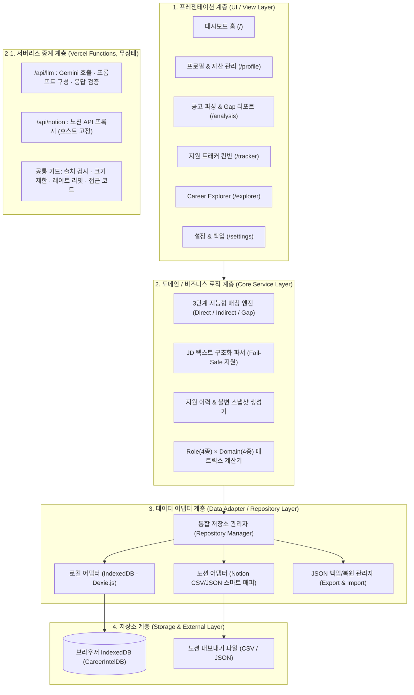

# 시스템 아키텍처 (ARCHITECTURE.md)

이 문서는 **Career Intelligence**의 시스템 구조, 4계층 아키텍처(Layered Architecture), 데이터 모델(스키마), 디렉터리 구성 및 기술적 설계 의사결정을 정의하는 기준 문서입니다.

---

## 1. 시스템 개요 (System Overview)

- **아키텍처 패턴**: **Local-First 4-Layer Architecture (로컬 퍼스트 4계층 아키텍처)**
- **핵심 설계 철학**:
  - **프라이버시 중심 (Privacy-First)**: 구직자의 이력서, 자소서, 프로젝트 정보는 외부 중앙 서버에 **저장되지 않고** 사용자 브라우저(IndexedDB)에 격리 보관됩니다. AI 분석·노션 불러오기 실행 시에만 필요한 최소 내용이 **무상태(stateless) 서버리스 함수**를 거쳐 외부로 전달됩니다(저장·로그 없음, 사용자 동의 후).
  - **비밀 값 분리 (Secret Isolation)**: 운영 API 키는 서버 환경 변수 전용이며, 사용자 노션 토큰은 브라우저 보관 + 요청 시 중계만 합니다.
  - **어댑터 기반 확장성 (Adapter-Driven Extensibility)**: 로컬 저장소와 외부 데이터(예: 노션, 추후 링크드인 등)의 형식을 추상화하여, 새로운 데이터 소스가 추가되어도 UI나 매칭 로직이 영향을 받지 않는 구조를 유지합니다.
  - **불변 스냅샷 보존 (Immutable Snapshot)**: 지원 시점의 공고 원문과 제출 서류, 분석 결과는 최신 프로필 변경과 독립적으로 영구 보존됩니다.

---

## 2. 전체 시스템 구조도 (4-Layer Structure)



---

## 3. 데이터 모델 설계 (Data Models & TypeScript Interfaces)

### ① Profile (구직자 기본 프로필)
```typescript
export interface Profile {
  id: string; // 고유 ID (기본값: 'current-user')
  name: string; // 사용자 이름
  title: string; // 한 줄 소개 / 현재 직무
  targetRole: string; // 희망 직무 (예: AI Applied Engineer)
  targetDomains: string[]; // 관심 도메인 (예: ['소리 & 오디오', '미디어 & 생성형 AI'])
  skills: string[]; // 보유 기술 스택 태그 (예: ['PyTorch', 'FastAPI', 'Docker'])
  updatedAt: string; // 최근 수정 일시 (ISO String)
}
```

### ② Project (프로젝트 자산)
```typescript
export interface Project {
  id: string; // UUID
  title: string; // 프로젝트명
  period: {
    startDate: string; // 'YYYY-MM'
    endDate?: string; // 'YYYY-MM' (진행 중일 경우 undefined)
    isOngoing: boolean;
  };
  role: string; // 담당 역할
  techStack: string[]; // 사용 기술 스택 태그
  description: string; // 프로젝트 개요
  outcomes: string[]; // 정량적 성과 및 기여 내용 불릿 포인트
  links?: { title: string; url: string }[]; // 깃허브, 데모 링크
  createdAt: string;
  updatedAt: string;
}
```

### ③ JobDescription (채용 공고 구조화 모델)
```typescript
export interface JobDescription {
  id: string;
  company: string; // 기업명
  role: string; // 채용 직무
  domain: string; // 산업/기술 분야
  rawText: string; // 공고 원문 전체 (Fail-Safe 보존)
  sourceUrl?: string; // 공고 원본 URL
  sections: {
    responsibilities: string[]; // 주요 업무
    qualifications: string[]; // 자격 요건
    preferred: string[]; // 우대 사항
  };
  parsedAt: string;
}
```

### ④ AnalysisResult (3단계 지능형 매칭 & Gap 분석 결과)
```typescript
export interface MatchEvidence {
  requirement: string; // 공고의 요구사항 문장
  matchedSkillOrExperience: string; // 매칭된 기술 또는 프로젝트 성과
  projectId?: string; // 근거 프로젝트 ID
  description: string; // 구체적 매칭 근거 설명
}

export interface AnalysisResult {
  id: string;
  jdId: string;
  directMatches: MatchEvidence[]; // 🟢 직접 증명된 역량
  indirectMatches: MatchEvidence[]; // 🔵 간접 연결 경험
  evidenceGaps: {
    requirement: string;
    missingReason: string;
    actionGuide: string; // 자기소개서/포트폴리오 보완 가이드
  }[]; // 🟠 증거 공백
  summaryScore: number; // 종합 역량 충족도 점수 (과장 없는 객관적 지표, 0~100)
  analyzedAt: string;
}
```

### ⑤ Application (지원 이력 & 불변 스냅샷)
```typescript
export type ApplicationStatus = 'READY' | 'SUBMITTED' | 'INTERVIEW' | 'ACCEPTED' | 'REJECTED';

export interface Application {
  id: string;
  company: string;
  role: string;
  domain: string;
  status: ApplicationStatus;
  appliedDate?: string;
  notes?: string;

  // ★ 불변 스냅샷 (당시 지원 시점의 자료를 통째로 보존)
  snapshot: {
    jdSnapshot: JobDescription; // 당시 공고 원본
    resumeText: string; // 당시 제출한 자기소개서 전문
    portfolioUrl?: string; // 포트폴리오 링크
    analysisSnapshot: AnalysisResult; // 당시 매칭 분석 결과
    snapshotTimestamp: string; // 스냅샷 생성 일시
  };

  createdAt: string;
  updatedAt: string;
}
```

### ⑥ NotionMappingConfig & Schema Discovery (노션 동적 스키마 감지 및 매핑 모델)
```typescript
// 사용자 노션 DB의 속성 메타데이터 (동적 감지)
export interface NotionPropertyMeta {
  id: string;
  name: string; // 노션 컬럼 이름 (예: '과제명', 'Tech Stack', '진행기간')
  type: string; // 'title' | 'multi_select' | 'select' | 'rich_text' | 'date' | 'url' 등
}

// 스키마 스캔 결과 객체
export interface NotionSchemaDiscovery {
  databaseId: string;
  databaseTitle: string;
  properties: NotionPropertyMeta[]; // 감지된 모든 컬럼 목록
}

// 사용자 정의 1:1 매핑 규칙
export interface NotionMappingConfig {
  id: string; // 'current-notion-config'
  sourceType: 'API' | 'CSV' | 'JSON';
  // 참고: 현재 구현은 토큰을 이 레코드(IndexedDB)에 저장하지 않는다.
  // 토큰·DB ID는 localStorage('ci.notion.credentials', "기억하기" 선택 시)에만 보관하고,
  // 백업 JSON에는 apiKey를 항상 빈 값으로 내보낸다. (아래 필드는 하위 호환용)
  apiConfig?: {
    apiKey: string; // 현재 미사용(항상 빈 값). 노션 내부 통합 토큰은 저장하지 않음
    databaseId: string;
  };
  columnMappings: {
    title: string; // 노션 컬럼 ⟷ 프로젝트명 매핑
    techStack: string; // 노션 컬럼 ⟷ 기술 스택(태그) 매핑
    period: string; // 노션 컬럼 ⟷ 기간 매핑
    outcomes: string; // 노션 컬럼 ⟷ 수행 성과(불릿) 매핑
    role?: string; // 노션 컬럼 ⟷ 담당 역할 매핑 (선택)
    links?: string; // 노션 컬럼 ⟷ 링크 매핑 (선택)
  };
  lastSyncedAt?: string; // 최근 동기화 일시
}
```

---

## 4. 디렉터리 및 코드 구조 (`src/`)

```text
src/
├── db/
│   └── index.ts                 # Dexie DB 클래스(CareerIntelDB), 기본 프로필·샘플 시딩 헬퍼
├── features/                    # 도메인 중심 기능 모듈 (각 폴더는 index.ts로 공개)
│   ├── profile/                 # 프로필 & 프로젝트 자산 (ProfileView, ProjectModal, ProjectCard …)
│   ├── jd-analysis/             # 공고 등록·목록·상세 (jdParserService.ts: 정규식 파서)
│   ├── matching/                # matchingEngine.ts (3단계 매칭) + MatchingReportModal
│   ├── applications/            # 지원 트래커: 칸반, 불변 스냅샷 모달, applicationHelper.ts
│   ├── explorer/                # explorerEngine.ts + 4×4 매트릭스 UI
│   ├── notion/                  # notionAdapter.ts(스키마 감지·매핑·변환) + NotionAdapterPanel
│   ├── backup/                  # backupService.ts(내보내기·검증·복원) + BackupPanel
│   └── ai/                      # aiClient.ts(/api 호출·동의·접근 코드), AiAssist(버튼 3종), AiSettingsPanel
├── types/                       # profile.ts · analysis.ts · application.ts · notion.ts
├── App.tsx                      # 탭 기반 셸 (useState, URL 라우팅 없음)
├── main.tsx
└── index.css

api/                             # Vercel 서버리스 함수 (얇은 래퍼)
├── llm.ts · notion.ts · health.ts
server/                          # 서버 공통 코어 (프레임워크 독립, 단위 테스트 대상)
├── http.ts                      # 요청 가드(출처·크기·접근 코드), 레이트 리미터
├── prompts.ts                   # 프롬프트 생성(인젝션 완화), 응답 검증(수치 날조 차단)
├── llmHandler.ts                # Gemini 호출 (키는 서버 환경 변수에서만 읽음)
├── notionHandler.ts             # 노션 프록시 (토큰·ID 형식 검증, 호스트 고정)
└── nodeAdapter.ts               # Node 요청 ↔ 코어 변환 (Vercel · Vite 개발 서버 공용)

tests/                           # Vitest: db · jdParser · matchingEngine · applications · explorer
                                 #         notionAdapter · backup · server  (총 49개)
vite.config.ts                   # 개발 서버에서 /api/* 를 위 server/ 핸들러로 처리
```

> 위 트리는 **현재 구현 기준**입니다(2026-11-04). 초기 설계안에 있던 `components/`, `services/`, `utils/`, `dashboard/`, 별도 `schema.ts`는 만들지 않았고, 서비스 로직은 각 `features/` 폴더 안에 함께 둡니다. 대시보드는 아직 `App.tsx` 내부의 요약 화면입니다.

---

## 5. 데이터 흐름 및 상태 관리

1. **상태 관리 방식**: 현재는 `App.tsx`의 `useState`와 각 뷰의 로컬 상태 + Dexie 조회로 구성합니다. (초기 설계의 Context/커스텀 훅은 규모가 커질 때 도입 예정)
2. **데이터 갱신**: 저장·복원·가져오기 후 각 뷰가 `onDataRefresh`/`loadData` 콜백으로 DB를 다시 읽어 화면을 갱신합니다. (`useLiveQuery` 기반 자동 갱신은 미도입)
3. **노션 데이터 유입 흐름** (두 채널):
   - 파일/붙여넣기: `CSV·JSON` ➔ `notion` 모듈이 헤더 자동 인식 ➔ 매핑 추천·사용자 확인 ➔ `Project` 변환 ➔ `IndexedDB` 일괄 저장.
   - 실시간: 브라우저(토큰·DB ID 입력) ➔ `/api/notion`(검증 후 노션 API 중계, 미저장) ➔ 응답 JSON ➔ 위와 동일한 파서·매핑 흐름.
4. **AI 분석 흐름** (사용자가 버튼을 눌렀을 때만, 동의 후): 브라우저가 필요한 최소 데이터 구성(이름 제외) ➔ `/api/llm`(가드 통과 → 프롬프트 구성 → Gemini 호출) ➔ 서버가 JSON 응답을 검증(스키마, 입력에 없던 요구사항·수치 제거) ➔ UI 표시. **AI 결과는 참고용이며 DB·분석 스냅샷에 저장하지 않고 객관적 충족도 점수를 바꾸지 않는다.**

---

## 6. 테스트 전략 (`tests/`)

- **테스트 러너**: Vitest
- **단위 테스트 (Unit Test)**:
  - `matchingEngine.test.ts`: 키워드 과장 없이 직접/간접/Gap이 올바르게 분류되는지 검증.
  - `jdParser.test.ts`: 다양한 형식의 채용공고 텍스트에서 주요업무, 자격요건, 우대사항이 정확히 파싱되는지 검증.
  - `notionAdapter.test.ts`: 노션 CSV/API JSON 스키마 감지, 매핑 추천·검증, 프로젝트 변환 검증.
  - `backup.test.ts`: 백업 왕복, 형식 검증, 구버전 호환, 노션 키 제외 검증.
  - `server.test.ts`: 요청 가드, 레이트 리밋, Gemini·노션 호출(모킹), 프롬프트 안전장치, 응답 검증 (실제 외부 호출 없음).
- **회귀 방지**: 비즈니스 로직을 변경할 때마다 테스트 스위트를 자동 실행하여 기존 분석 결과가 왜곡되지 않도록 보장.
