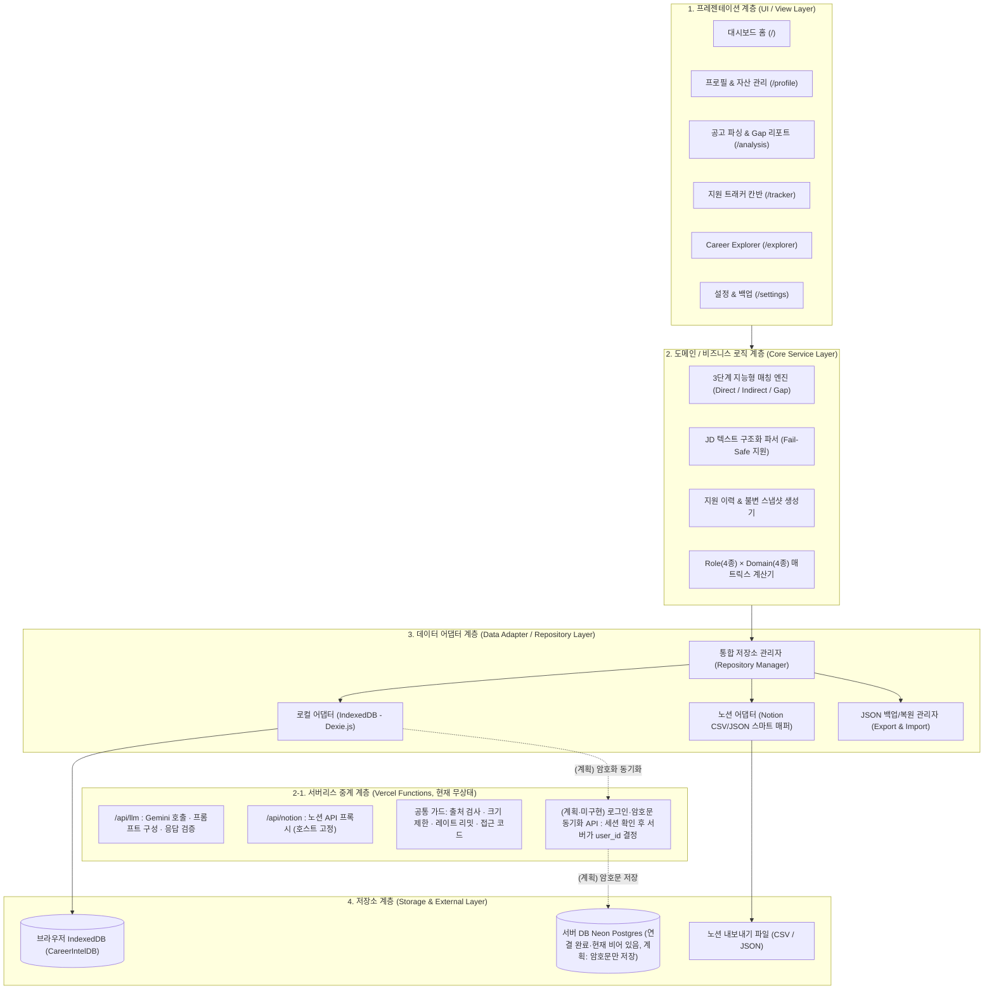

# 시스템 아키텍처 (ARCHITECTURE.md)

이 문서는 **Career Intelligence**의 시스템 구조, 4계층 아키텍처(Layered Architecture), 데이터 모델(스키마), 디렉터리 구성 및 기술적 설계 의사결정을 정의하는 기준 문서입니다.

---

## 1. 시스템 개요 (System Overview)

- **아키텍처 패턴**: **Local-First 4-Layer Architecture (로컬 퍼스트 4계층 아키텍처)**
- **핵심 설계 철학**:
  - **프라이버시 중심 (Privacy-First)**: 구직자의 이력서, 자소서, 프로젝트 정보는 외부 중앙 서버에 **저장되지 않고** 사용자 브라우저(IndexedDB)에 격리 보관됩니다. AI 분석·노션 불러오기 실행 시에만 필요한 최소 내용이 **무상태(stateless) 서버리스 함수**를 거쳐 외부로 전달됩니다(저장·로그 없음, 사용자 동의 후). *(2026-11-06 구현 완료·배포 전: 계정 기능을 쓰는 사용자는 브라우저에서 암호화한 사본만 서버 DB(Neon)에 동기화되며 서버 운영자는 내용을 읽을 수 없습니다. 계정 기능은 서버에 `BETTER_AUTH_SECRET`이 있어야 켜지고, 없으면 위가 그대로 현재 동작입니다. 3-1 ⑥~⑦, 3-2, 3-3 참고.)*
  - **비밀 값 분리 (Secret Isolation, 방문자별 BYOK)**: 방문자마다 노션 계정·DB·Gemini 키가 다르므로 서버에는 방문자의 비밀 값을 두지 않습니다. 방문자가 입력한 Gemini 키·노션 토큰은 방문자 브라우저에만 보관(기본 `sessionStorage`, 선택 시 `localStorage`)하고 호출 때만 서버를 통과합니다. 운영자 본인의 Gemini 키(서버 환경 변수)는 접근 코드가 맞을 때만 쓰이며 공개 배포에서는 등록하지 않는 것을 권장합니다.
  - **어댑터 기반 확장성 (Adapter-Driven Extensibility)**: 로컬 저장소와 외부 데이터(예: 노션, 추후 링크드인 등)의 형식을 추상화하여, 새로운 데이터 소스가 추가되어도 UI나 매칭 로직이 영향을 받지 않는 구조를 유지합니다.
  - **불변 스냅샷 보존 (Immutable Snapshot)**: 지원 시점의 공고 원문과 제출 서류, 분석 결과는 최신 프로필 변경과 독립적으로 영구 보존됩니다.

---

## 2. 전체 시스템 구조도 (4-Layer Structure)



---

## 3. 데이터 모델 설계 (Data Models & TypeScript Interfaces)

### ① Profile (구직자 기본 프로필)
```typescript
export interface Profile {
  id: string; // 고유 ID (기본값: 'current-user')
  name: string; // 사용자 이름
  title: string; // 한 줄 소개 / 현재 직무
  targetRole: string; // 희망 직무 (예: AI Applied Engineer)
  targetDomains: string[]; // 관심 도메인 (예: ['소리 & 오디오', '미디어 & 생성형 AI'])
  skills: string[]; // 보유 기술 스택 태그 (예: ['PyTorch', 'FastAPI', 'Docker'])
  // 연락처·가림 규칙(7-0): AI 전송 전 가림 용도, 서버 동기화 시에는 본문과 분리된 별도 암호 칸(contact_enc)
  email?: string;
  phone?: string;
  address?: string;
  redactTerms?: string[]; // 사용자 지정 가림 단어(학교·이전 회사·영문 이름 표기 등)
  updatedAt: string; // 최근 수정 일시 (ISO String)
}
```

### ② Project (프로젝트 자산)
```typescript
export interface Project {
  id: string; // UUID
  title: string; // 프로젝트명
  period: {
    startDate: string; // 'YYYY-MM'
    endDate?: string; // 'YYYY-MM' (진행 중일 경우 undefined)
    isOngoing: boolean;
  };
  role: string; // 담당 역할
  techStack: string[]; // 사용 기술 스택 태그
  description: string; // 프로젝트 개요
  outcomes: string[]; // 정량적 성과 및 기여 내용 불릿 포인트
  links?: { title: string; url: string }[]; // 깃허브, 데모 링크
  createdAt: string;
  updatedAt: string;
}
```

### ③ JobDescription (채용 공고 구조화 모델)
```typescript
export interface JobDescription {
  id: string;
  company: string; // 기업명
  role: string; // 채용 직무
  domain: string; // 산업/기술 분야
  rawText: string; // 공고 원문 전체 (Fail-Safe 보존)
  sourceUrl?: string; // 공고 원본 URL
  sections: {
    responsibilities: string[]; // 주요 업무
    qualifications: string[]; // 자격 요건
    preferred: string[]; // 우대 사항
  };
  parsedAt: string;
}
```

### ④ AnalysisResult (3단계 지능형 매칭 & Gap 분석 결과)
```typescript
export interface MatchEvidence {
  requirement: string; // 공고의 요구사항 문장
  matchedSkillOrExperience: string; // 매칭된 기술 또는 프로젝트 성과
  projectId?: string; // 근거 프로젝트 ID
  description: string; // 구체적 매칭 근거 설명
}

export interface AnalysisResult {
  id: string;
  jdId: string;
  directMatches: MatchEvidence[]; // 🟢 직접 증명된 역량
  indirectMatches: MatchEvidence[]; // 🔵 간접 연결 경험
  evidenceGaps: {
    requirement: string;
    missingReason: string;
    actionGuide: string; // 자기소개서/포트폴리오 보완 가이드
  }[]; // 🟠 증거 공백
  summaryScore: number; // 종합 역량 충족도 점수 (과장 없는 객관적 지표, 0~100)
  analyzedAt: string;
  // 선택(Phase 5 3단계): 'v2-ai' = 기업 맥락을 반영한 AI 심층 분석 스냅샷. 없으면 v1(규칙 기반)
  analysisVersion?: string;
  aiInsight?: { summary: string; items: { requirement: string; assessment: 'strong' | 'partial' | 'weak'; reason: string; improvement: string }[]; model: string; companyContextUsed: boolean };
}
```

### ⑤ Application (지원 이력 & 불변 스냅샷)
```typescript
export type ApplicationStatus = 'READY' | 'SUBMITTED' | 'INTERVIEW' | 'ACCEPTED' | 'REJECTED';

export interface Application {
  id: string;
  company: string;
  role: string;
  domain: string;
  status: ApplicationStatus;
  appliedDate?: string;
  notes?: string;

  // ★ 불변 스냅샷 (당시 지원 시점의 자료를 통째로 보존)
  snapshot: {
    jdSnapshot: JobDescription; // 당시 공고 원본
    resumeText: string; // 당시 제출한 자기소개서 전문
    portfolioUrl?: string; // 포트폴리오 링크
    analysisSnapshot: AnalysisResult; // 당시 매칭 분석 결과
    snapshotTimestamp: string; // 스냅샷 생성 일시
  };

  createdAt: string;
  updatedAt: string;
}
```

### ⑥ NotionMappingConfig & Schema Discovery (노션 동적 스키마 감지 및 매핑 모델)
```typescript
// 사용자 노션 DB의 속성 메타데이터 (동적 감지)
export interface NotionPropertyMeta {
  id: string;
  name: string; // 노션 컬럼 이름 (예: '과제명', 'Tech Stack', '진행기간')
  type: string; // 'title' | 'multi_select' | 'select' | 'rich_text' | 'date' | 'url' 등
}

// 스키마 스캔 결과 객체
export interface NotionSchemaDiscovery {
  databaseId: string;
  databaseTitle: string;
  properties: NotionPropertyMeta[]; // 감지된 모든 컬럼 목록
}

// 사용자 정의 1:1 매핑 규칙
export interface NotionMappingConfig {
  id: string; // 'current-notion-config'
  sourceType: 'API' | 'CSV' | 'JSON';
  // 참고: 현재 구현은 토큰을 이 레코드(IndexedDB)에 저장하지 않는다.
  // 토큰·DB ID는 sessionStorage('ci.notion.credentials', 탭을 닫으면 삭제)에 두고,
  // "계속 기억하기"를 선택한 경우에만 localStorage에 보관한다.
  // 백업 JSON에는 apiKey를 항상 빈 값으로 내보낸다. (아래 필드는 하위 호환용)
  apiConfig?: {
    apiKey: string; // 현재 미사용(항상 빈 값). 노션 내부 통합 토큰은 저장하지 않음
    databaseId: string;
  };
  columnMappings: {
    title: string; // 노션 컬럼 ⟷ 프로젝트명 매핑
    techStack: string; // 노션 컬럼 ⟷ 기술 스택(태그) 매핑
    period: string; // 노션 컬럼 ⟷ 기간 매핑
    outcomes: string; // 노션 컬럼 ⟷ 수행 성과(불릿) 매핑
    role?: string; // 노션 컬럼 ⟷ 담당 역할 매핑 (선택)
    links?: string; // 노션 컬럼 ⟷ 링크 매핑 (선택)
  };
  lastSyncedAt?: string; // 최근 동기화 일시
}
```

---

## 3-1. 승인 확장: 기업 분석 & 맞춤 문서 생성 (2026-11-06 승인 · 구현 완료·배포 전)

> 설계 초안을 구현하면서 **일부가 달라졌습니다**(아래 ①~④에 실제 구현 기준으로 정리). 달라진 점: 기업 자료는 `CompanyProfile` 대신 단순한 `CompanyMaterial`, 생성 문서는 `body/claims` 대신 `sections/paragraphs(+근거)`, `fit-analysis` 별도 작업 없이 `match-insight` 확장, 기업 자료 URL은 서버가 robots.txt를 확인한 뒤 읽기를 시도(실패 시 붙여넣기 안내). 상세 요구사항은 `PRD.md` 2-2, 실제 타입은 `src/types/documents.ts`.

### ① 새 데이터 모델 (구현됨 — `src/types/documents.ts`)
```typescript
export type DocKind = 'RESUME' | 'COVER_LETTER' | 'PORTFOLIO';

// 과거 이력서·자소서·포트폴리오 원문. 저장 전 이름·연락처는 {{이름}} 등 자리표시자로 치환
export interface SourceDocument { id; kind: DocKind; title; body; createdAt; updatedAt }

// 공고별 기업 자료(붙여넣기 / URL 읽기 / Google 검색). URL 읽기는 서버가 robots.txt 확인 후 시도하고 실패 시 사유 기록·붙여넣기 안내(AGENTS.md 9절)
export interface CompanyMaterial {
  id; jdId; sourceType: 'PASTE' | 'URL'; title; url?; content; collectedAt;
  status: 'OK' | 'FAILED'; failureReason?; summary?: CompanySummary; updatedAt;
}
export interface CompanySummary { overview; keyPoints: string[]; talentTraits: string[]; generatedAt; model }

// AI 생성 문서 — 덮어쓰지 않고 새 버전으로 보존(previousVersionId). 문단마다 근거 연결
export interface GeneratedDocument {
  id; kind: DocKind; jdId; title; sections: { heading; paragraphs: { text; evidence: EvidenceRef[] }[] }[];
  generatedAt; model; analysisVersion; status: 'DRAFT' | 'CONFIRMED'; previousVersionId?; updatedAt;
}
export interface EvidenceRef { type: 'project' | 'outcome' | 'skill' | 'source'; refId; label }  // outcome 의 refId = `프로젝트ID#순번`
```
- 동기화 보조(로컬 전용): `SyncRecord`(테이블:id → 서버 수정 번호·해시·seq), `SyncStateItem`(커서 등), `SyncConflict`(충돌에서 진 쪽 사본).

### ② DB 마이그레이션 (Dexie — 구현됨)
- `version(1)`: 기존 6개 테이블(변경 없음). `version(2)`: 동기화 보조 3개(`syncRecords` `syncState` `syncConflicts`)만 추가. `version(3)`: `sourceDocuments` `companyMaterials` `generatedDocuments` 추가. 기존 테이블 정의·데이터는 그대로입니다.
- 백업/복원: `BACKUP_TABLES`에 문서 테이블 3개 추가, `BACKUP_VERSION` 2 → 3. **구버전(v1·v2) 백업도 복원 가능**(없는 테이블은 빈 배열). 동기화 보조 테이블, 노션 토큰·Gemini 키는 백업에서 제외.

### ③ 서버 처리 (평문 비저장)
- `LlmTask`는 9개(구현됨): `parse-jd` `match-insight`(기업 맥락 선택 입력 추가) `polish` `company-summary` `generate-resume`(어필 포인트 입력 추가) `generate-cover-letter` `generate-portfolio` `company-search`(Google 검색 도구, 유료 선언 헤더 필요·출처 없으면 거부) `extract-keywords`(원문에 없는 단어 제거). 별도 `fit-analysis` 작업은 만들지 않았습니다.
- 서버 검증(구현됨): 응답 스키마, **인용한 근거에 없던 새 수치가 든 문단 제외**, 근거 ID가 요청에 실제로 있던 것인지 확인하고 없는 ID 제거, **근거가 하나도 없는 문단 폐기**(제외된 문단 수는 화면에 안내). 고유명사 검증은 하지 않음(한계).
- 한 요청에 모두 몰지 않고 **단계별 요청**으로 나눔 (요청당 40초 예산, 본문 60KB 제한). 관련 근거 선별은 브라우저에서 먼저 수행.
- 서버 함수는 문서·기업 자료의 **평문을 저장하지 않음**(계정 동기화 구현 후에도 서버 DB에는 암호문만 저장). 기존 정책(AI 결과 미저장)도 유지하며 생성 문서는 **사용자가 저장을 눌렀을 때만** 브라우저 DB에 저장(계정 사용자는 이후 암호화 동기화).

### ④ 내보내기 (브라우저에서 생성, 서버 불필요)
- 이력서·자소서(구현됨): PDF(브라우저 인쇄 창에서 "PDF로 저장"), Word `.docx` — `docx` 라이브러리, 내보내기를 누를 때만 불러옴
- 포트폴리오(구현됨): PDF, `.pptx` — `pptxgenjs`. **구형 `.ppt`는 지원하지 않음**(PPTX 사용 안내). DOCX·PPTX 파일 구조와 한글 포함은 자동 시험으로 확인했지만, Word/PowerPoint/뷰어에서 열었을 때의 모양은 직접 확인하지 못함
- 두 라이브러리는 설치·사용 중입니다(`npm audit`: `pptxgenjs`의 하위 패키지 `image-size`에 경고가 있으나 이미지 삽입을 쓰지 않음).

### ⑤ 서버 DB 연결 (Neon · 2026-11-06 연결 완료, 앱은 계정 기능에서 사용)
- **Neon(Postgres 18.6)** 을 Vercel Marketplace로 연결했습니다(`career-intelligence-db`, Free, `iad1`, 로그인 기능 `auth=false`). Vercel 서버 함수(`api/`)에서만 접근하고, 브라우저에서 DB에 직접 접속하지 않습니다(연결 문자열이 노출되므로). 연결 후 마이그레이션 0001~0003으로 테이블 18개(+`schema_migrations`)를 만들었고, 사용자 데이터는 0건입니다(공개 전 점검 항목).
- 앱은 `server/db/client.ts`의 지연 초기화 Pool(`@neondatabase/serverless`)로만 DB에 접근합니다. `DATABASE_URL`과 `BETTER_AUTH_SECRET`이 모두 있어야 계정 기능이 켜지며(`/api/health`의 `accounts`), 없으면 DB를 전혀 쓰지 않고 기존 로컬 전용 동작 그대로입니다.
- 접근 방식(확정): Neon 서버리스 드라이버의 WebSocket `Pool`(로그인 서비스·트랜잭션에 필요), 런타임은 `DATABASE_URL`, 마이그레이션은 `DATABASE_URL_UNPOOLED`. 실제 Neon에서 가입→저장→재로그인→탈퇴 흐름을 가짜 계정으로 확인함. 연결 정보는 환경 변수로만 보관.

### ⑥ 서버 DB 구조 — B 방식(브라우저 암호화) (2026-11-06 · 사용자 수용, 구현·Neon 적용 완료)
- **파일**: `database/migrations/0001_accounts_and_group1.sql`(계정·키·설정·동의·동기화 3개), `0002_groups_2_to_4.sql`(동기화 5개, 분석·생성 문서는 DB 트리거로 추가 전용), `0003_auth_tables.sql`(로그인 서비스 5개). 로컬 Postgres 엔진 PGlite(PostgreSQL 18.6)와 실제 Neon에 적용해 시험함. 최초 SQL 초안(`docs/drafts/`, 로컬 전용·GitHub 제외)은 이 파일들로 대체되었으며 `id`가 `uuid`가 아닌 `text`로, 동기화용 `seq` 칸과 복구 키 검증 칸이 추가되는 등 달라졌습니다.
- **공개 서비스·계정별 데이터**: 누구나 개인 계정을 만들어 쓰며, 로그인은 Better Auth(직접 설치)가 처리하고 `users.auth_subject`로 연결합니다(이메일·비밀번호 해시는 로그인 서비스 테이블에 있음, 7-1 스파이크로 선정).
- **암호화 구조 — 비밀번호 하나(파생 방식, 권장안 승인으로 기록)**: 브라우저가 비밀번호에서 PBKDF2-SHA256(600,000회 이상 — OWASP 권장, 2026-11-06 확인)으로 마스터 키를 만들고 HKDF로 **로그인용 값**과 **열쇠용 값** 둘로 갈라서, 서버(로그인 서비스)에는 로그인용 값만 보냄(진짜 비밀번호와 열쇠는 서버에 가지 않음). 사용자마다 브라우저가 무작위 데이터 키(DEK)를 만들어 열쇠용 값으로 감싸 `user_keys`에 보관하고, 복구 키로 한 번 더 감싼 사본을 둠(복구 키는 가입 때 필수 표시·저장 확인). 서비스가 파생값을 비밀번호로 받아주지 않으면 별도 "데이터 암호 구문" 방식(비밀번호 2개)으로 전환. 로그인 전 salt를 어떻게 조회할지(계정 존재 여부 노출 방지)는 7-2에서 설계. 각 레코드는 AES-256-GCM(nonce 12바이트, AAD=테이블+user_id+id)으로 암호화한 `payload_enc` 한 칸에 사용자가 쓴 내용 전부를 담고, 서버는 `user_id`·id·부모 id·순서·시각·수정 번호(revision)·삭제 표시만 봄.
- **서버가 알 수 있는 것**: 어떤 사용자가 몇 개의 레코드를 언제 수정했는지, 레코드 크기, 부모-자식 관계(어느 성과가 어느 프로젝트 소속인지). 내용(회사명·제목·본문·날짜·기술 스택·이름·연락처)은 알 수 없음.
- **격리·삭제**: 기본키 `(user_id, id)`, 자식 테이블의 복합 외래키로 다른 사용자의 부모 지정 불가(로컬 엔진에서 검증). 탈퇴 = `users` 행 삭제 → 전부 연쇄 삭제 + 키 행 삭제로 백업에 남은 암호문도 복호화 불가("키 폐기"). Neon 무료 플랜의 복구 이력은 최대 6시간(공식 플랜 페이지, 2026-11-06 확인) — 그 시간 동안은 삭제 전 암호문이 복구 이력에 남을 수 있으나 키 행도 삭제되므로 복호화할 수 없음.
- **한계**: 서버 검색·정렬·통계 불가(브라우저에서 복호화 후 처리). AI 호출 순간에는 선택된 내용이 복호화되어 서버 함수를 거쳐 Gemini로 전달됨(저장은 암호화, 전송 순간은 평문). 암호화 코드는 직접 작성해야 하며 실수하면 보안이 약해지므로 별도 검토·시험 필요. 행 단위 접근 규칙(RLS)은 초안에 미포함.

### ⑦ 결정 반영: 동기화·연락처 분리·AI 전송 차단 (2026-11-06 · 구현 완료)
- **동기화(절충안 채택)**: 브라우저(IndexedDB)가 주 저장소이고, 서버 DB는 **암호화된 사본 동기화**. 로그아웃 시 "이 기기 데이터 삭제"(미동기화 변경이 있으면 경고 후 진행). 후속으로 로컬 저장소도 같은 데이터 키로 암호화. 서버는 `revision`(수정 번호)과 `deleted_at`(삭제 표시)로 충돌·삭제를 전달. 보안 비교: B에서는 두 방식 모두 서버에 암호문만 있어 서버 유출 위험은 같고, 차이는 기기에 평문이 남는지(서버가 주이면 메모리에만 둘 수 있어 더 안전하나 오프라인 불가·변경 폭 큼).
- **이름·연락처 별도 칸**: `profiles.contact_enc`(이름·이메일·전화·주소 + 사용자 지정 가림 단어)와 `profiles.payload_enc`(프로필 본문)를 분리(AAD 다르게). 이력서·자소서·포트폴리오 원문은 저장 전에 연락처 값을 자리표시자(`{{이름}}`·`{{이메일}}`·`{{전화}}`)로 바꿔 저장하고 내보내기 때만 브라우저에서 합성.
- **AI 전송 차단 3겹(구현됨, 7-0)**: ① 모든 AI 호출이 `callLlmDetailed` 한 관문을 거치며 프로필 본문(이름 제외)만 구성 ② 모든 문자열에서 등록한 이름·이메일·전화·주소·가림 단어와 이메일·전화·주민번호 형태를 `{{이름A}}` 같은 토큰으로 가린 뒤 **재검사하여 남아 있으면 전송 중단**, 응답 토큰은 복원(다듬기의 모르는 토큰 제안은 폐기) ③ 서버 `/api/llm`이 이메일·전화·주민번호 패턴이 남은 요청을 400으로 거부(서버는 이름을 알 수 없음).
- **한계**: 이름의 다른 표기(영문·약칭), 학교·회사·프로젝트명 등 간접 식별 정보는 자동으로 가릴 수 없음. 무료 Gemini 티어는 입력이 서비스 개선에 쓰일 수 있으므로(공식 가격 페이지 확인) 실질적 방어는 "전송하지 않는 것". 유료 티어는 사용되지 않는다고 명시됨.
- **로그인**: Better Auth(직접 설치) 선정·구현(7-1 스파이크 → 7-4). 한 비밀번호 방식의 PBKDF2·HKDF는 WebCrypto가 기본 지원(HTTPS 전용, Argon2 미지원). 비밀번호 12자 이상(제 제안값, 공식 기준 아님), 복구 키 필수. 이메일 인증·메일 재설정은 도메인 구입 후.

---

## 3-2. 서버 DB 전체 구조 설계 — B 방식, 4묶음 21개 테이블 (2026-11-06 · 장기 목표 설계, 일부만 구현)

> **이 절은 장기 목표 설계입니다.** 실제 구현은 더 단순해서 레코드 단위 테이블 8개(성과·요구사항·섹션 등은 부모 레코드의 암호문 안에 포함)만 만들었습니다 — 구현 기준은 **3-3**을 따르세요. 아래 21개 테이블 중 세분화된 테이블은 필요해질 때(서버 검색·통계 등) 앞으로 가는 마이그레이션으로 추가합니다.

### 공통 규칙
- **암호화 레코드 테이블의 공통 칸**: `user_id`, `id`(브라우저가 만든 UUID), `payload_enc`, `payload_nonce`(12바이트), `key_version`, `revision`(수정 번호), `created_at`, `updated_at`, `deleted_at`(삭제 표시). 기본키 `(user_id, id)`, 자식은 `(user_id, 부모id)` 복합 외래키.
- **평문(구조 정보)**: 소유자·id·부모 id·순서·종류 구분값·시각·수정 번호·모델 이름/분석 버전/요금제 선언값(감사용). **암호문(`payload_enc`) 안**: 이름·회사명·제목·본문·날짜·기술 스택·점수·메모·상태 등 사용자 내용.
- **추가 전용(수정·삭제 불가, 탈퇴·부모 삭제의 연쇄 삭제만 허용)**: `consents`, `company_analyses`, `job_analyses`, `fit_analyses`, `fit_evidence`, `application_snapshots`, 확정(`CONFIRMED`)된 `generated_documents`와 하위. DB 트리거로 강제하는 방안은 구현 시 검증.
- **근거 참조**: 근거는 (`project_id`/`outcome_id`/`source_document_id`) 평문 참조 + 당시 문장 사본(암호문). 원본이 나중에 수정·삭제돼도 분석·문서가 바뀌지 않도록 참조 외래키는 삭제 시 참조 칸만 비움(PostgreSQL 15 이상의 열 지정 `ON DELETE SET NULL (칸)` 사용 예정 — 구현 시 시험으로 확인).
- **중복 방지 한계**: 회사명 등이 암호문이라 서버에서 `UNIQUE(user_id, 회사명)`을 걸 수 없음 → 브라우저에서 복호화 후 확인.
- **요청 처리**: 서버는 세션에서 `user_id`를 정하고 클라이언트가 보낸 `user_id`는 신뢰하지 않음. 모든 질의에 `user_id` 조건을 붙이고, 두 계정으로 서로 안 보이는 시험을 필수로 함.

### 테이블 목록
| 묶음 | 테이블 | 평문(구조) 칸 | 암호문 안의 내용 | 비고 |
| :--- | :--- | :--- | :--- | :--- |
| 1 (구현됨 — 단순화된 형태는 3-3) | `users`, `user_keys`, `user_settings`, `consents`, `profiles`, `projects`, `project_outcomes`, `source_documents` | 초안 SQL 참고 | 프로필 본문/연락처(별도 칸), 프로젝트, 성과 한 줄, 과거 이력서·자소서·포트폴리오 원문(연락처는 자리표시자) | `docs/drafts/0001_group1_schema.sql` |
| 2 | `companies` | — | 기업명, 산업, 웹사이트, 메모 | 사용자별 보관 |
| | `company_sources` | `company_id`, `status`(MANUAL/FETCHED/FAILED), `collected_at` | URL, 제목, 발췌, 실패 사유 | 원문 전체 저장 금지(발췌·요약·링크) |
| | `company_analyses` | `company_id`, `model`, `tier_declared`, `analysis_version`, `created_at` | 사업·기술·문화·최근 소식 요약 | 추가 전용, 버전 |
| | `job_postings` | `company_id`, `parsed_by`(RULE/AI), `parsed_at` | 직무명, 산업, 공고 URL, **공고 원문 전체** | 원문 보존 필수 |
| | `job_requirements` | `job_posting_id`, `section`(RESPONSIBILITY/QUALIFICATION/PREFERRED), `position` | 요구사항 문장 | 근거 연결의 기준 행 |
| | `job_analyses` | `job_posting_id`, `model`, `tier_declared`, `analysis_version`, `created_at` | 핵심 키워드, 요구 기술, 연차, 업무 요약 | 추가 전용 |
| 3 | `fit_analyses` | `job_posting_id`, `company_analysis_id`(선택), `model`(규칙 기반이면 비움), `analysis_version`, `analyzed_at` | 충족도 점수, 요약 | 추가 전용. 점수는 합격 확률이 아님 |
| | `fit_evidence` | `fit_analysis_id`, `level`(DIRECT/INDIRECT/GAP), `requirement_id`/`project_id`/`outcome_id`/`source_document_id`(참조, 선택) | 요구사항 문장 사본, 근거 인용문 사본, 설명, 보완 가이드 | 추가 전용 |
| | `applications` | `job_posting_id`(선택) | 회사·직무·산업·**상태**(READY/SUBMITTED/INTERVIEW/ACCEPTED/REJECTED)·지원일·메모 | 지원 사실 자체가 민감하므로 상태도 암호화 |
| | `application_snapshots` | `application_id`, `snapshot_at` | 당시 공고, 제출 자료, 분석 결과 | 수정·삭제 불가. 한 행 최대 크기 상향 필요(구현 시 결정) |
| 4 | `generated_documents` | `job_posting_id`, `application_id`(선택), `kind`(RESUME/COVER_LETTER/PORTFOLIO), `version`, `status`(DRAFT/CONFIRMED), `model`, `tier_declared`, `analysis_version`, `fit_analysis_id`, `company_analysis_id`, `generated_at`, `confirmed_at` | 제목 | `UNIQUE(user_id, job_posting_id, kind, version)`, 확정 후 수정 불가 |
| | `document_sections` | `document_id`, `position` | 소제목, 본문(이력서·자소서=문단, 포트폴리오=슬라이드 1장) | |
| | `section_evidence` | `section_id`, `project_id`/`outcome_id`/`source_document_id`(참조) | 근거 인용문 사본 | 확정 후 수정 불가 |

### 현재 브라우저 DB와의 대응
| 현재/계획 (IndexedDB) | 서버 테이블 |
| :--- | :--- |
| `profiles` | `profiles` (+ 연락처 전용 칸) |
| `projects` | `projects` + `project_outcomes` (성과 배열을 행으로 분리) |
| `jobDescriptions` | `job_postings` + `job_requirements` |
| `analysisResults` | `fit_analyses` + `fit_evidence` (직접/간접/공백 배열을 행으로 통합) |
| `applications` | `applications` + `application_snapshots` |
| `notionConfigs` | `user_settings`(암호문, 노션 토큰 제외) |
| `sourceDocuments`(계획) | `source_documents` |
| `companyProfiles`(계획) | `companies` + `company_sources` + `company_analyses` |
| `generatedDocuments`(계획) | `generated_documents` + `document_sections` + `section_evidence` |
- 어긋남 해소(2026-11-06): 로컬 `AnalysisResult`에 선택 필드 `analysisVersion`·`aiInsight`를 추가해 `AGENTS.md` 6절(분석 기준·버전 기록) 원칙과 맞췄습니다. 기존 v1 분석은 필드 없이 그대로 유효합니다.

### 동기화·API (구현됨 — 3-3 참고)
- 실제 경로·방식은 3-3 참고. Vercel 무료(Hobby) 제약(함수 12개, 본문 4.5MB 등)을 지키기 위해 `api/account.ts` 함수 1개가 모든 경로를 처리하고, 이 경로만 본문 한도를 1MB로 둡니다.
- 브라우저가 주 저장소이므로 서버 장애 시에도 앱은 계속 동작. 로그아웃 시 이 기기 데이터 삭제(미동기화 변경 경고). 후속으로 로컬 저장소도 같은 데이터 키로 암호화.

---

## 3-3. 구현된 계정·동기화 구조 (2026-11-06, 구현 완료·배포 전 — 구현 기준)
- **로그인**: Better Auth(직접 설치, `server/account/auth.ts`) — 이메일 인증 없음, 시도 제한은 DB 저장(`rateLimit`), 세션 7일. 비밀번호 칸에는 브라우저가 파생한 "로그인용 값"(43자)만 도착.
- **키 구조**: 비밀번호 → PBKDF2-SHA256(600,000회) → HKDF → ①로그인용 값 ②열쇠용 값(브라우저 밖으로 안 나감). 무작위 DEK를 ②와 복구 키로 각각 감싸 `user_keys`에 보관. 복구 키 소유 증명은 별도 파생 값의 SHA-256만 저장(`recovery_verifier`), 5회 실패 시 15분 잠금.
- **레코드 암호화**: AES-256-GCM, nonce 12바이트, AAD = `ci|v1|rec|테이블|user_id|id|칸`. 프로필의 이름·연락처는 별도 칸(`contact_enc`, 칸 이름이 AAD에 포함).
- **API**: `api/account.ts` 함수 1개 + `server/account/handler.ts` 경로 표(`/prelogin` `/signup` `/keys` `/me` `/password` `/recover-start` `/recover` `/delete` `/sync/pull` `/sync/push` + 로그인 서비스 경로 중 `/auth/sign-in/email`·`/auth/sign-out`만 통과). 모두 POST·같은 출처. 본문 한도는 이 경로만 1MB(레코드 1건 최대 512KB 암호문).
- **서버 DB 테이블 18개**: `users` `user_keys` `user_settings` `consents` + 동기화 8개(`profiles` `projects` `source_documents` `job_postings` `applications` `analysis_results` `company_materials` `generated_documents`; 분석 결과·생성 문서는 DB 트리거로 추가 전용) + 로그인 서비스 5개(`user` `session` `account` `verification` `rateLimit`) + `schema_migrations`. (`project_outcomes` 별도 테이블은 만들지 않고 성과 목록은 프로젝트 본문 안에 둠 — 문서 근거는 `프로젝트ID#순번`으로 참조.)
- **동기화**: 변경 감지는 "마지막으로 서버와 맞춘 해시와의 비교"(훅 없음), 서버 커서는 전역 시퀀스 `seq`(겹쳐 가져오기로 늦게 확정된 번호 보완), 충돌은 늦은 수정 우선+진 쪽 사본 보존, 삭제 표시는 30일 후 요청 중 정리. 로컬 보조 테이블 `syncRecords` `syncState` `syncConflicts`는 서버로 보내지 않음.
- **Phase 5**: 모든 생성 문서는 근거 ID 필수·새 수치 문단 제외(서버 검증), 이름·연락처는 자리표시자로 저장하고 내보낼 때만 합성, 수정·확정은 새 버전.

---

## 4. 디렉터리 및 코드 구조 (`src/`)

```text
src/
├── db/
│   └── index.ts                 # Dexie DB 클래스(CareerIntelDB), 기본 프로필·샘플 시딩 헬퍼
├── features/                    # 도메인 중심 기능 모듈 (각 폴더는 index.ts로 공개)
│   ├── profile/                 # 프로필 & 프로젝트 자산 (ProfileView, ProjectModal, ProjectCard …)
│   ├── jd-analysis/             # 공고 등록·목록·상세 (jdParserService.ts: 정규식 파서)
│   ├── matching/                # matchingEngine.ts (3단계 매칭) + MatchingReportModal
│   ├── applications/            # 지원 트래커: 칸반, 불변 스냅샷 모달, applicationHelper.ts
│   ├── explorer/                # explorerEngine.ts + 4×4 매트릭스 UI
│   ├── notion/                  # notionAdapter.ts(스키마 감지·매핑·변환) + NotionAdapterPanel
│   ├── backup/                  # backupService.ts(내보내기·검증·복원) + BackupPanel
│   ├── ai/                      # aiClient.ts(AI 호출 관문: 동의·개인정보 가림·복원), piiGuard.ts, AiAssist(버튼 3종), AiSettingsPanel
│   ├── account/                 # accountClient.ts(가입·로그인·복구·키 처리), AccountContext, AccountPanel, policy.ts(처리 안내)
│   ├── sync/                    # syncEngine.ts(상태 비교 동기화·충돌·로그아웃 삭제)
│   ├── analysis/                # keywords.ts: 규칙 기반 키워드 추출·대조·어필 후보 (6-C)
│   └── documents/               # fileExtract.ts(PDF·DOCX 글자 추출), documentService.ts(근거 선별·변환·버전), exporters.ts(DOCX·PPTX·PDF), DocumentsView(과거 자료·기업 자료·생성·검수)
├── types/                       # profile.ts · analysis.ts · application.ts · notion.ts · documents.ts
├── utils/                       # piiRedaction.ts(가림·복원·자리표시자), crypto/(키 파생·감싸기·레코드 암호화)
├── App.tsx                      # 탭 기반 셸 (useState, URL 라우팅 없음)
├── main.tsx
├── vite-env.d.ts                # Vite 환경 타입 선언 (import.meta.env.DEV 등)
└── index.css

api/                             # Vercel 서버리스 함수 (얇은 래퍼)
├── llm.ts · models.ts · notion.ts · health.ts · account.ts · read-url.ts   # 6개 / 무료 한도 12개
server/                          # 서버 공통 코어 (프레임워크 독립, 단위 테스트 대상)
├── http.ts                      # 요청 가드(출처·크기·접근 코드), 레이트 리미터
├── prompts.ts                   # 프롬프트 생성(인젝션 완화), 응답 검증(수치 날조 차단)
├── gemini.ts                    # 키 결정(방문자 키/운영자 키+접근 코드), 모델 목록 조회·순위·캐시, 업스트림 오류 해석
├── modelsHandler.ts             # /api/models: 사용 가능 모델 목록
├── llmHandler.ts                # Gemini 호출 (방문자 키 헤더 우선, 운영자 키는 접근 코드 일치 시에만, 둘 다 없으면 거부)
├── notionHandler.ts             # 노션 프록시 (방문자 토큰만 사용, 접근 코드 불필요, 호스트 고정)
├── nodeAdapter.ts               # Node 요청 ↔ 코어 변환 (Vercel · Vite 개발 서버 공용), 경로 표
├── urlReadHandler.ts            # /api/read-url: robots.txt 확인·내부망(SSRF) 차단·본문 추출 (6-B)
├── piiGuard.ts                  # 서버 안전망: 이메일·전화·주민번호 형태가 남은 요청 거부
├── account/                     # handler.ts(경로 표), auth.ts(Better Auth 설정), store.ts(저장소 함수: 모두 user_id 필수)
└── db/                          # client.ts(Neon Pool 지연 초기화), migrate.ts(실행기), types.ts
database/migrations/             # 0001~0003 SQL (순서·체크섬 관리)
scripts/                         # db-migrate.ts · neon-smoke.ts · release-check.ts · gen-auth-migration.mjs (사람이 직접 실행)

tests/                           # Vitest 21개 파일, 총 247개 (db · jdParser · matchingEngine · applications · explorer · notionAdapter · backup · server
                                 #   · piiRedaction · aiPayload · crypto · migrate · account · sync · documents · documentsServer)
vite.config.ts                   # 개발 서버에서 /api/* (및 /api/account/*)를 위 server/ 핸들러로 처리
vercel.json                      # 배포 보안 헤더 (CSP, X-Frame-Options, Referrer-Policy, HSTS, /api 캐시 금지) + /api/account/* rewrite
public/favicon.svg               # 파비콘 (앱 로고: 인디고 + Sparkles). public/ 의 나머지는 v0 템플릿 잔여 이미지
```

> 위 트리는 **현재 구현 기준**입니다(2026-11-06 갱신). 초기 설계안에 있던 `components/`, `services/`, `utils/`, `dashboard/`, 별도 `schema.ts`는 만들지 않았고, 서비스 로직은 각 `features/` 폴더 안에 함께 둡니다. 대시보드는 아직 `App.tsx` 내부의 요약 화면입니다.

---

## 5. 데이터 흐름 및 상태 관리

1. **상태 관리 방식**: 현재는 `App.tsx`의 `useState`와 각 뷰의 로컬 상태 + Dexie 조회로 구성합니다. (초기 설계의 Context/커스텀 훅은 규모가 커질 때 도입 예정)
2. **데이터 갱신**: 저장·복원·가져오기 후 각 뷰가 `onDataRefresh`/`loadData` 콜백으로 DB를 다시 읽어 화면을 갱신합니다. (`useLiveQuery` 기반 자동 갱신은 미도입)
3. **노션 데이터 유입 흐름** (두 채널):
   - 파일/붙여넣기: `CSV·JSON` ➔ `notion` 모듈이 헤더 자동 인식 ➔ 매핑 추천·사용자 확인 ➔ `Project` 변환 ➔ `IndexedDB` 일괄 저장.
   - 실시간: 브라우저(토큰·DB ID 입력) ➔ `/api/notion`(검증 후 노션 API 중계, 미저장) ➔ 응답 JSON ➔ 위와 동일한 파서·매핑 흐름.
4. **AI 모델 선택**: 사용자가 고른 모델 > 운영자 `GEMINI_MODEL` > 자동. 자동은 키로 `models`를 조회해 Flash 안정판 최신순으로 정렬하고(TTS·이미지 등 제외), 403/404/5xx/시간 초과면 다음 후보로 넘어간다(최대 6개, 전체 40초 예산, 시도당 15초). 실패한 모델은 같은 서버 인스턴스 메모리에서 10분간 후순위로 밀린다(서버 재시작·인스턴스 교체 시 초기화). 응답에는 사용된 `model`과 먼저 실패해 건너뛴 `attempts`가 포함된다. 사용자가 직접 고른 모델은 재시도하지 않는다.
5. **AI 분석 흐름** (사용자가 버튼을 눌렀을 때만, 동의 후): 브라우저가 필요한 최소 데이터 구성(이름 제외) ➔ `/api/llm`(가드 통과 → 프롬프트 구성 → Gemini 호출) ➔ 서버가 JSON 응답을 검증(스키마, 입력에 없던 요구사항·수치 제거) ➔ UI 표시. **AI 결과는 참고용이며 DB·분석 스냅샷에 저장하지 않고 객관적 충족도 점수를 바꾸지 않는다.**
6. **맞춤 문서 생성 흐름 (2026-11-06 구현 완료, 상세는 3-1)**: ① 브라우저가 공고 요구사항과 겹치는 프로젝트를 골라 근거 목록(ID 부여)을 만들고 기업 요약·과거 자료 발췌를 더함(이름·연락처 가림) ➔ ② `/api/llm`의 `company-summary` / `match-insight`(기업 맥락) / `generate-*`를 단계별로 호출 ➔ ③ 서버가 근거 ID 확인·새 수치 문단 제외·근거 없는 문단 폐기 ➔ ④ 브라우저가 가림 토큰을 복원하고 이름·연락처를 자리표시자로 바꿔 `GeneratedDocument`(초안)로 IndexedDB에 저장 ➔ ⑤ 검수 화면에서 수정·확정(저장할 때마다 새 버전) ➔ ⑥ 내보내기 때만 이름·연락처를 합성해 PDF/DOCX/PPTX 생성. AI 서버 함수는 계속 무상태.

---

## 6. 테스트 전략 (`tests/`)

- **테스트 러너**: Vitest
- **단위 테스트 (Unit Test)**:
  - `matchingEngine.test.ts`: 키워드 과장 없이 직접/간접/Gap이 올바르게 분류되는지 검증.
  - `jdParser.test.ts`: 다양한 형식의 채용공고 텍스트에서 주요업무, 자격요건, 우대사항이 정확히 파싱되는지 검증.
  - `notionAdapter.test.ts`: 노션 CSV/API JSON 스키마 감지, 매핑 추천·검증, 프로젝트 변환 검증.
  - `backup.test.ts`: 백업 왕복, 형식 검증, 구버전 호환, 노션 키 제외 검증.
  - `server.test.ts`: 요청 가드, 레이트 리밋, Gemini·노션 호출(모킹), 프롬프트 안전장치, 응답 검증 (실제 외부 호출 없음).
  - `piiRedaction.test.ts`·`aiPayload.test.ts`: 개인정보 가림·복원·재검사, AI 호출 관문(모킹). `crypto.test.ts`: 표준 벡터·변조·AAD. `migrate.test.ts`: 실행기·제약·추가 전용. `account.test.ts`: 가입·로그인·복구·제한·격리·평문 부재·탈퇴(로컬 가짜 DB). `sync.test.ts`: 두 기기 동기화·충돌·중단 후 재개. `documents.test.ts`·`documentsServer.test.ts`: 근거 선별·검증·내보내기 파일 구조.
- **회귀 방지**: 비즈니스 로직을 변경할 때마다 테스트 스위트를 자동 실행하여 기존 분석 결과가 왜곡되지 않도록 보장.
