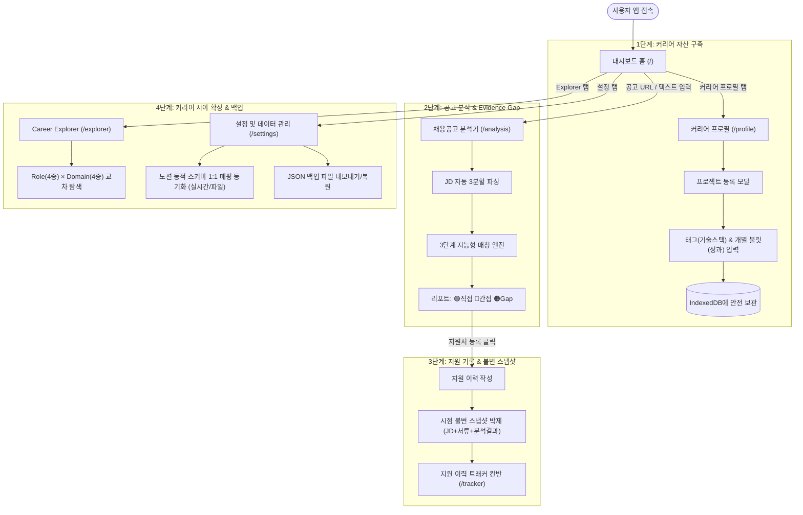

# 화면 설계서 (UI_UX.md)

이 문서는 **Career Intelligence**의 전체 화면 구조(Sitemap), 화면별 상세 레이아웃 및 텍스트 와이어프레임, 사용자 인터랙션 흐름, UI 디자인 원칙을 정의하는 단일 진실 공급원(SSoT) 화면 설계 문서입니다.

---

## 1. UX 디자인 원칙 & 비주얼 시스템

- **신뢰와 가독성 중심 (Data-Driven & Clean)**: 구직자의 소중한 커리어 자산과 긴 채용 공고(JD)를 다루므로 눈이 피로하지 않은 차분한 다크 슬레이트(Slate) 배경과 지적인 인디고(Indigo), 활력을 주는 에메랄드(Emerald) 포인트 컬러를 적용합니다.
- **카드(Card)형 구조화**: 복잡한 텍스트 정보를 흩어놓지 않고 의미 단위의 독립된 카드로 묶어 입문자도 한눈에 정보 위계를 파악할 수 있도록 돕습니다.
- **3단계 신호등 뱃지 시스템 (Evidence Badge System)**:
  - 🟢 **직접 증명 경험 (Direct Evidence)**: 프로젝트 성과 및 수치로 완벽히 검증된 역량 (초록색)
  - 🔵 **간접 연결 경험 (Transferable / Indirect)**: 유사 기술이나 인접 경험으로 충분히 어필 가능한 역량 (파란색)
  - 🟠 **증거 공백 (Evidence Gap)**: 공고에서 요구하지만 아직 증거가 부족해 보완이 필요한 영역 (주황색)
- **합격률 과장 금지**: '합격 확률 85%' 같은 자극적이고 불확실한 숫자 대신 **'역량 요건 충족도(직접/간접/공백 건수)'**로 객관적인 사실만을 전달합니다.
- **Fail-Safe(안전망) 안내**: 크롤링이나 연동이 차단되더라도 에러 창 대신 "직접 복사/붙여넣기" 폼으로 자연스럽게 안내하여 사용자의 작업을 중단시키지 않습니다.

---

## 2. 전체 페이지 구조 (Sitemap)

> 구현 참고: 현재는 URL 라우팅 없이 **탭 전환(`useState`)** 방식입니다. 아래 `(/경로)`는 화면 식별용 이름이며 실제 URL이 아닙니다.

```text
Career Intelligence
├── 🏠 대시보드 홈 (/)                  # 요약 통계 + 빠른 JD 분석 입력창 + 최근 지원 파이프라인
├── 👤 커리어 프로필 (/profile)            # 인적사항/희망분야 관리 + 프로젝트 자산(태그/불릿) CRUD
├── 🔍 채용공고 분석기 (/analysis)          # JD 파싱 & 3단계 매칭(Direct/Indirect/Gap) 심층 리포트
├── 📋 지원 이력 트래커 (/tracker)          # 칸반 보드 / 테이블 뷰 + 당시 시점 불변 스냅샷 열람
├── 🧭 Career Explorer (/explorer)       # 직무(Role 4종) × 도메인(Domain 4종) 교차 적합도 매트릭스
└── ⚙️ 설정 & 데이터 관리 (/settings)       # 노션 동적 스키마 연동(실시간/파일) + JSON 백업/복원 + AI 설정
```

---

## 3. 화면별 상세 레이아웃 & 텍스트 와이어프레임

---

### ① 대시보드 홈 (`/`)

앱 실행 시 가장 먼저 마주하는 종합 관제탑입니다. 내 커리어 자산 규모, 최근 지원 진행 상황을 파악하고, 새로운 채용 공고를 즉시 분석창에 던져 넣을 수 있습니다.

```text
+---------------------------------------------------------------------------------------------------------+
| [Logo] Career Intelligence         [홈] [커리어 프로필] [공고분석] [지원트래커] [Explorer]   [⚙ 설정/백업] |
+---------------------------------------------------------------------------------------------------------+
|                                                                                                         |
|  👋 안녕하세요, 지은님! 오늘도 목표 커리어를 향해 한 걸음 나아가볼까요?                                 |
|  📁 등록된 커리어 자산: 프로젝트 4건 · 핵심 기술 태그 8개 · 관심 분야: [AI Applied Engineer]            |
|                                                                                                         |
|  +---------------------------------------------------------------------------------------------------+  |
|  | 🚀 빠른 채용 공고(JD) 분석 시작하기                                                               |  |
|  |                                                                                                   |  |
|  | [ 공고 URL 입력 (예: 원티드, 사람인 링크 등)...                         ] [ 🔍 공고 가져오기 ]   |  |
|  |                                                                                                   |  |
|  | ▼ [선택] 또는 공고 텍스트 직접 복사/붙여넣기 (크롤링이 막힌 사이트일 때 클릭하세요)               |  |
|  | +-----------------------------------------------------------------------------------------------+ |  |
|  | | [주요 업무], [자격 요건], [우대 사항]이 포함된 채용 공고 전문을 여기에 붙여넣으세요...        | |  |
|  | +-----------------------------------------------------------------------------------------------+ |  |
|  |                                                                        [ ⚡ 지능형 분석 시작하기 ] |  |
|  +---------------------------------------------------------------------------------------------------+  |
|                                                                                                         |
|  [ 📊 최근 지원 파이프라인 현황 ]                              [ 🎯 추천 인접 커리어 & 도메인 ]          |
|  +----------------------------------------------------------+  +-------------------------------------+  |
|  | 준비중(2) ➔ 서류제출(3) ➔ 면접진행(1) ➔ 최종합격(0)       |  | • AI Applied Engineer               |  |
|  | -------------------------------------------------------- |  |   └ 추천 도메인: [소리 & 오디오]    |  |
|  | • [예시테크] AI 음성 모델 엔지니어 (면접 진행 중 · 82% 부합) |  | • MLOps Engineer                    |  |
|  | • [샘플소프트] MLOps 플랫폼 개발자 (서류 심사 중 · 68% 부합)   |  |   └ 추천 도메인: [미디어·생성형 AI] |  |
|  | • [샘플페이] 데이터 분석가 (지원서 작성 중)                   |  |                                     |  |
|  |                                                          |  | 내 기술(PyTorch, Docker)과 연계     |  |
|  | [ + 전체 지원 이력 트래커로 이동하기 ➔ ]                 |  | [ 🧭 Career Explorer에서 탐색하기 ➔]|  |
|  +----------------------------------------------------------+  +-------------------------------------+  |
+---------------------------------------------------------------------------------------------------------+
```

---

### ② 커리어 프로필 & 프로젝트 자산 (`/profile`)

내 모든 경력과 성과를 정형 데이터로 영구 보관하는 핵심 창고입니다. 좌측에는 기본 정보와 대표 기술 스택, 우측에는 상세 프로젝트 카드가 2열(1:2 비중)로 배치됩니다.

```text
+---------------------------------------------------------------------------------------------------------+
| [Logo] Career Intelligence         [홈] [커리어 프로필] [공고분석] [지원트래커] [Explorer]   [⚙ 설정/백업] |
+---------------------------------------------------------------------------------------------------------+
| 👤 커리어 프로필 & 프로젝트 자산 관리                                                                    |
| 실제 경험 기반의 프로젝트 성과 불릿을 체계적으로 구조화하여 JD 매칭의 확실한 근거로 활용합니다.         |
+---------------------------------------------------+-----------------------------------------------------+
| [ 좌측: 기본 프로필 카드 (Sticky) ]               | [ 우측: 프로젝트 자산 목록 (자산 관리) ]            |
|                                                   |                                                     |
| [ ✏️ 프로필 기본정보 수정 ]                        | [ 🔍 프로젝트 검색/태그 필터 ] [ + 새 프로젝트 등록 ] |
| • 이름: 이지은                                    |                                                     |
| • 한 줄 소개: 데이터 중심 실전형 AI 엔지니어      | +-------------------------------------------------+ |
| • 희망 직무: AI Applied Engineer                  | | 📁 [프로젝트 1] 멀티모달 음성 합성 파이프라인    | |
| • 관심 도메인:                                    | |   🗓️ 2024.01 ~ 2024.06 (6개월) · 역할: 모델링 리드| |
|   [소리 & 오디오] [미디어 & 생성형 AI]            | |   🛠️ [PyTorch] [FastAPI] [Docker] [ONNX]        | |
|                                                   | |   📝 대규모 오디오 데이터를 활용한 저지연 E2E 모델| |
| • 대표 보유 기술 스택 (총 8개):                   | |   🎯 핵심 성과 (Evidence Bullets):              | |
|   [PyTorch ✕] [FastAPI ✕] [Docker ✕]             | |     • ONNX Runtime 양자화로 지연시간 35% 단축    | |
|   [ONNX ✕] [Kubernetes ✕] [SQL ✕]                 | |     • 비동기 스트리밍 추론 API 서버 독자 설계     | |
|   [ + 기술 태그 입력 후 Enter...        ]         | |   🔗 [GitHub 리포지토리] [기술 블로그 정리]      | |
|                                                   | |                                [✏️ 수정] [🗑️ 삭제] | |
| [ 💡 안내 ]                                       | +-------------------------------------------------+ |
| 프로젝트에 등록된 모든 기술 스택과 성과 불릿은    | | 📁 [프로젝트 2] RAG 기반 사내 문서 지식 검색봇  | |
| 채용공고 분석 시 '직접 증명 근거'로 자동 대조됨   | |   🗓️ 2023.08 ~ 2023.12 (5개월) · 역할: AI/백엔드 | |
|                                                   | |   🛠️ [LangChain] [ChromaDB] [OpenAI] [FastAPI]   | |
|                                                   | |   🎯 핵심 성과:                                  | |
|                                                   | |     • 하이브리드 검색 도입으로 검색 정확도 22% ↑  | |
|                                                   | |                                [✏️ 수정] [🗑️ 삭제] | |
|                                                   | +-------------------------------------------------+ |
+---------------------------------------------------+-----------------------------------------------------+
```

#### [모달 와이어프레임: 프로젝트 추가/수정 팝업]

```text
+---------------------------------------------------------------------------------+
| 📁 프로젝트 자산 등록 / 수정                                                [✕] |
+---------------------------------------------------------------------------------+
| 프로젝트명 *                                                                    |
| [ 예: 실시간 멀티모달 음성 합성 모델 서빙 파이프라인 개발                    ] |
|                                                                                 |
| 시작 년월 *              종료 년월                진행 여부                     |
| [ 2024-01       ]  ~  [ 2024-06       ]       [ ] 현재 진행 중인 프로젝트       |
|                                                                                 |
| 담당 역할 *                                                                     |
| [ 예: 딥러닝 모델 경량화 및 프로덕션 추론 API 서빙 전담                      ] |
|                                                                                 |
| 사용 기술 스택 (태그) *                                                         |
| [PyTorch ✕] [FastAPI ✕] [Docker ✕] [ONNX ✕]                                    |
| [ 기술명을 입력하고 Enter나 쉼표를 누르세요 (예: TensorRT)                    ] |
|                                                                                 |
| 프로젝트 개요 (한 줄 설명)                                                      |
| [ 예: 음성 변환 모델의 연산량을 줄여 모바일/웹 환경에서 실시간 서빙 가능케 함 ] |
|                                                                                 |
| 🎯 핵심 성과 불릿 (JD 매칭 엔진의 직접 증거로 사용됩니다) *                      |
| 💡 단순 나열보다는 '정량적 수치(% 개선, ms 단축)'와 '구체적 역할'을 적어주세요.  |
| +-----------------------------------------------------------------------------+ |
| | 1. [ ONNX 양자화를 적용해 추론 지연시간을 120ms에서 78ms로 35% 단축        ] | | [🗑️]
| | 2. [ FastAPI 비동기 큐 기반으로 동시 요청 50건 처리 성능 확보              ] | | [🗑️]
| +-----------------------------------------------------------------------------+ |
| [ + 성과 항목(불릿) 추가하기 ]                                                  |
|                                                                                 |
| 링크 (GitHub, 데모 사이트, 회고 블로그 등 선택사항)                             |
| [ 라벨: GitHub 리포지토리 ] [ URL: https://github.com/my-project          ] [🗑️]
| [ + 링크 추가하기 ]                                                             |
+---------------------------------------------------------------------------------+
|                                                   [ 취소 ]  [ 프로젝트 저장 ]   |
+---------------------------------------------------------------------------------+
```

---

### ③ 채용공고 분석기 & Evidence Gap 리포트 (`/analysis/:id`)

입력된 채용 공고를 3개 섹션으로 자동 구조화하고, 내 커리어 자산과 대조하여 **직접 증거(Direct), 간접 연결(Indirect), 증거 공백(Evidence Gap)**을 객관적으로 도출합니다.

```text
+---------------------------------------------------------------------------------------------------------+
| [Logo] Career Intelligence         [홈] [커리어 프로필] [공고분석] [지원트래커] [Explorer]   [⚙ 설정/백업] |
+---------------------------------------------------------------------------------------------------------+
| ← 대시보드로 돌아가기      공고명: [예시테크] AI Applied Engineer (오디오/음성 모델링)     분석시점: 2026.11.03 |
+---------------------------------------------------+-----------------------------------------------------+
| [ 좌측: 구조화된 채용공고 (JD Parser) ]           | [ 우측: 3단계 지능형 매칭 & Gap 분석 결과 리포트 ]  |
|                                                   |                                                     |
| 🏢 회사: 예시테크 · 부서: 음성 AI 연구소      | 📊 직무 요건 부합 요약 (총 8개 항목 분석)           |
|                                                   | [ 🟢 직접 증명 4건 ]  [ 🔵 간접 연결 2건 ]  [ 🟠 Gap 2건 ]|
| 📋 [주요 업무]                                    |                                                     |
| • E2E 음성 합성 및 보코더 모델 경량화 연구         | 🟢 직접 증명된 역량 (프로젝트 성과 기반)            |
| • 모바일 및 저사양 디바이스 대상 실시간 추론 최적화| • PyTorch 기반 딥러닝 모델링                         |
| • 대규모 오디오 데이터셋 정제 파이프라인 구축     |   └ 근거: [프로젝트 1] 멀티모달 음성 합성 (성과 1번)|
|                                                   | • 추론 지연시간 최적화 (Latency 단축 경험)          |
| 📌 [자격 요건]                                    |   └ 근거: [프로젝트 1] ONNX 양자화 35% 단축 달성    |
| • 딥러닝 프레임워크(PyTorch 등) 활용 2년 이상     |                                                     |
| • 모델 경량화(Quantization, Pruning) 실무 경험    | 🔵 간접 연결 가능한 역량 (경험 확장 어필 포인트)   |
| • C++ 및 저지연 API 서빙 파이프라인 구축 역량    | • 대규모 오디오 데이터 정제 파이프라인              |
|                                                   |   └ 연관 근거: FastAPI 비동기 데이터 큐 처리 경험   |
| ⭐ [우대 사항]                                    |                                                     |
| • Triton 또는 TensorRT 기반 대규모 서빙 경험      | 🟠 증거 공백 (Evidence Gap & 자기소개서 보완 가이드)|
| • 음성 합성/신호처리 분야 상위 학회 논문 게재     | • C++ 기반 실시간 모델 서빙 경험 미증명             |
|                                                   |   💡 보완 가이드: 실무 경험이 없다면 C++ 추론 엔진  |
| [ ✏️ 공고 내용 직접 수정/보완하기 ]                |      스터디나 ONNX C++ 런타임 토이프로젝트 경험을   |
|                                                   |      자기소개서 '학습 민첩성' 항목에 녹여내세요!    |
|                                                   |                                                     |
|                                                   | +-------------------------------------------------+ |
|                                                   | | 📥 이 분석 결과를 바탕으로 지원서 등록하기      | |
|                                                   | |    (현재 시점의 JD + 분석 리포트 불변 저장)    | |
|                                                   | +-------------------------------------------------+ |
+---------------------------------------------------+-----------------------------------------------------+
```

---

### ④ 지원 이력 트래커 (`/tracker`)

내가 지원한 모든 회사의 파이프라인을 시각적으로 추적하고, 지원 당시 제출했던 **공고 원문, 제출 자기소개서, 매칭 분석 결과**를 시간이 지나도 변하지 않는 **불변 스냅샷(Immutable Snapshot)**으로 열람합니다.

```text
+---------------------------------------------------------------------------------------------------------+
| [Logo] Career Intelligence         [홈] [커리어 프로필] [공고분석] [지원트래커] [Explorer]   [⚙ 설정/백업] |
+---------------------------------------------------------------------------------------------------------+
| 📋 지원 이력 트래커 (Application Tracker)                                                               |
| 지원 단계별 현황을 관리하고, 지원 당시의 제출 서류와 분석 결과를 불변 스냅샷으로 영구 보존합니다.       |
|                                                                                                         |
| [ 뷰 전환: ▣ 칸반 보드 뷰 | ☷ 테이블 뷰 ]      [ 🔍 회사/직무 검색... ]        [ + 새 지원 이력 직접 추가 ] |
+-------------------+-------------------+-------------------+-------------------+---------------------+
| 1. 준비 중 (2)    | 2. 서류 제출 (3)  | 3. 면접 전형 (1)  | 4. 최종 합격 (0)  | 5. 불합격/보류 (1)  |
+-------------------+-------------------+-------------------+-------------------+---------------------+
| +---------------+ | +---------------+ | +---------------+ | (비어 있음)       | +-----------------+ |
| | 샘플페이          | | | 샘플소프트        | | | 예시테크        | |                   | | 샘플웍스         | |
| | 데이터 분석가 | | | MLOps 엔지니어| | | AI Applied Eng| |                   | | AI 리서처       | |
| | 접수: ~11.15  | | | 접수: 11.01   | | | 1차: 11.08    | |                   | | 결과: 10.25 서류| |
| | 부합도: 75%   | | | 부합도: 68%   | | | 부합도: 82%   | |                   | | [복기 메모]     | |
| | [스냅샷 열람] | | | [스냅샷 열람] | | | [스냅샷 열람] | |                   | | [스냅샷 열람]   | |
| +---------------+ | +---------------+ | +---------------+ |                   | +-----------------+ |
| +---------------+ | +---------------+ |                   |                   |                     |
| | 샘플모빌리티    | | | 샘플마켓          | |                   |                   |                     |
| | 자율주행 모델 | | | ML 플랫폼     | |                   |                   |                     |
| | [스냅샷 열람] | | | [스냅샷 열람] | |                   |                   |                     |
| +---------------+ | +---------------+ |                   |                   |                     |
+-------------------+-------------------+-------------------+-------------------+---------------------+
```

#### [모달 와이어프레임: 불변 스냅샷 상세 뷰어 (Snapshot Modal)]

```text
+---------------------------------------------------------------------------------+
| 📜 [예시테크] AI Applied Engineer 지원 상세 스냅샷                           [✕]  |
| 🔒 이 기록은 지원 당시(2026.11.03)의 스냅샷으로, 현재 프로필이 변경되어도 보존됩니다. |
+---------------------------------------------------------------------------------+
| [ 탭 1: 당시 지원공고(JD) 원문 ]  [ 탭 2: 제출 서류(자소서/링크) ]  [ 탭 3: 당시 Gap 분석 리포트 ] |
+---------------------------------------------------------------------------------+
| 현재 전형 상태: [ 3. 면접 전형 ▼ ]    지원 일자: 2026.11.03                      |
|                                                                                 |
| 📝 [탭 2 내용 미리보기: 제출 자기소개서 및 포트폴리오]                          |
| • 제출 이력서 버전: `2026_상반기_이지은_AI엔지니어_v2.pdf`                     |
| • 포트폴리오 링크: https://my-portfolio.com/audio-ai                            |
| • 주요 어필 항목:                                                               |
|   "프로젝트 1의 ONNX Runtime 35% Latency 개선 성과를 자격 요건의 모델 경량화와  |
|    직접 연결하여 어필함."                                                       |
|                                                                                 |
| 📌 면접 복기 및 메모:                                                           |
| [ 1차 기술 면접에서 C++ 서빙 경험 질문 나옴. 학습 계획 중심으로 답변 완료.    ] |
|                                                                                 |
| 🔒 [탭 3 내용: 지원 당시 3단계 역량 분석 결과]                                  |
| • 당시 판정: 직접 증명 4건, 간접 연결 2건, Evidence Gap 2건                     |
+---------------------------------------------------------------------------------+
|                                                   [ 닫기 ]  [ 상태/메모 저장 ]  |
+---------------------------------------------------------------------------------+
```

---

### ⑤ Career Explorer (`/explorer`)

내 보유 기술을 바탕으로 내가 미처 생각지 못했던 **인접 직무(Role 4종)**와 **유망 산업 도메인(Domain 4종)**을 4×4 매트릭스로 교차 탐색하여 커리어 확장 가능성을 발견합니다.

```text
+---------------------------------------------------------------------------------------------------------+
| [Logo] Career Intelligence         [홈] [커리어 프로필] [공고분석] [지원트래커] [Explorer]   [⚙ 설정/백업] |
+---------------------------------------------------------------------------------------------------------+
| 🧭 Career Explorer (인접 직무 & 도메인 교차 탐색)                                                       |
| 내가 가진 기술(PyTorch, FastAPI, ONNX, Docker 등)을 재조합하여 더 넓은 커리어 기회를 탐색합니다.       |
+---------------------------------------------------+-----------------------------------------------------+
| [ 좌측: Role(4종) × Domain(4종) 적합도 매트릭스 ] | [ 우측: 선택된 조합 심층 진단 & 추천 로드맵 ]       |
|                                                   |                                                     |
| 구분 | AI Eng | AI Applied | MLOps | ML Eng       | 🎯 선택: [AI Applied Engineer] × [소리 & 오디오]    |
| -----+--------+------------+-------+-------       |                                                     |
| 소리 | [보통] |  [🌟최적]  | [보통]| [낮음]       | 💡 종합 매칭 적합도: 88% (매우 높음)                |
| 미디어| [높음] |  [높음]   | [보통]| [낮음]       |                                                     |
| 로봇 | [보통] |  [보통]   | [높음]| [낮음]       | 🟢 내 기술과의 접점:                                |
| 바이오| [낮음] |  [낮음]   | [낮음]| [보통]       | • PyTorch, ONNX, 스트리밍 서빙 경험이 완벽 부합     |
|                                                   | • 오디오 신호처리(STT/TTS) 분야에서 바로 전력화 가능|
| 💡 상태 범례:                                     |                                                     |
| [🌟최적]: 현재 보유 자산과 80% 이상 일치         | 🚀 추천 액션 & 학습 로드맵:                         |
| [높음]: 1~2개 인접 기술 보완 시 즉시 진입 가능   | 1. Kaldi/Librosa 기반 오디오 피처 추출 경험 보완    |
| [보통]: 기초 역량 보유, 프로젝트 1건 추가 추천    | 2. 저지연 WebRTC/FastRTC 실시간 통신 파이프라인 학습|
| [낮음]: 추가 학습 및 도메인 지식 습득 필요        |                                                     |
|                                                   | [ 🔍 이 조합에 맞는 채용공고 분석하러 가기 ➔ ]     |
+---------------------------------------------------+-----------------------------------------------------+
```

---

### ⑥ 설정 & 노션 연동 & 데이터 백업 & AI (`/settings`)

로컬 퍼스트 원칙에 따라 (현재) 데이터는 브라우저에만 저장합니다(계정·암호화 동기화는 아래 ⑧ 계획 참고). 노션 동적 매핑, 원클릭 JSON 백업/복원, AI 사용 설정(내 Gemini 키·동의·접근 코드)을 한 화면에서 관리합니다. **(현재 구현 기준 와이어프레임)**

```text
+---------------------------------------------------------------------------------------------------------+
| ⚙️ 설정 & 노션 연동 & 데이터 백업                                                                        |
+---------------------------------------------------+-----------------------------------------------------+
| [ 💾 로컬 퍼스트 데이터 관리 ]                    | [ 🔗 노션 동적 스키마 어댑터 ]                      |
| [ 📥 전체 데이터 JSON 백업 다운로드 ]             |  ┌ 노션에서 바로 불러오기 ───────────────────────┐ |
|  • 6개 테이블 전체 포함, 노션 API 키는 제외       |  │ [통합 토큰 ••••] [DB ID/주소]                 │ |
| ───────────────────────────────────────────────── |  │ ☐ 이 브라우저에 계속 기억하기 [불러오기]       │ |
| [ 📤 백업 파일에서 복원 ]                         |  └─────────────────────────────────────────────────┘ |
|  → 파일 검증 후 건수 요약 표시                    |  — 또는 CSV / JSON 직접 붙여넣기 / 파일 선택 —      |
|  → 복원 방식: (•) 병합  ( ) 전체 교체(확인창)     |  [ 스키마 감지 ]                                    |
|  → [ 복원 실행 ]  (단일 트랜잭션, 실패 시 롤백)   |  • 프로젝트명 * ⟵ [ 감지된 컬럼 ▼ ]  (자동 추천)    |
|                                                   |  • 기술 스택 *  ⟵ [ 감지된 컬럼 ▼ ]                 |
|                                                   |  • 기간 *       ⟵ [ 감지된 컬럼 ▼ ]                 |
|                                                   |  • 수행 성과 *  ⟵ [ 감지된 컬럼 ▼ ]                 |
|                                                   |  • 담당 역할 / 링크 (선택)                          |
|                                                   |  [ 프로젝트로 가져오기 (N행) ]  (제목 중복은 건너뜀) |
|                                                   |  ▼ 가져온 직후 "저장 확인" (바로 아래 표시)         |
|                                                   |  시도 N건 → DB 재조회 M건 (일치/불일치) · 전체 K건  |
|                                                   |  [표: 프로젝트명 | 기간 | 역할 | 기술 스택 | 성과 수] |
|                                                   |  ▸ 건너뛴 N건 보기 (행 번호 · 제목 · 사유)          |
+---------------------------------------------------+-----------------------------------------------------+
| [ 🤖 AI 분석 (Gemini) ]                                                                                  |
| 상태: 내 Gemini 키로 AI 사용 가능 / 키를 입력하세요 / 서버 미연결                                         |
| 내 Gemini API 키: [ •••••• ]  (Google AI Studio 무료 발급 링크)                                          |
| ☐ 이 브라우저에 계속 기억하기 (끄면 탭을 닫을 때 삭제 · 공용 PC에서는 끄세요)                             |
| 모델: [ 자동 (권장) ▼ ]  [ 사용 가능한 모델 불러오기 ]  (이 키로 쓸 수 있는 모델을 조회해 직접 선택 가능)  |
| ☐ 데이터 전송에 동의합니다. (전송 범위·무료 티어 고지 문구)                                               |
| 접근 코드: [ •••••• ]  (운영자 키를 쓰는 경우에만 · 서버에 APP_ACCESS_CODE가 있고 내 키가 비었을 때 표시) |
+---------------------------------------------------------------------------------------------------------+
```

**노션 가져오기 결과 확인 (2026-11-05 추가)**: `프로젝트로 가져오기`를 누르면 방금 저장하려던 항목을 IndexedDB에서 **다시 읽어** 건수가 일치하는지(시도 N건 vs 재조회 M건) 보여 주고, 가져온 프로젝트 표와 건너뛴 행(빈 제목·중복)의 사유를 바로 아래에 표시합니다. 이미 가져온 데이터를 다시 가져오면 모두 "중복"으로 건너뛰므로 표는 비고 건너뛴 목록만 나옵니다.

**AI 버튼 위치 (설정 외 화면)**
- 공고 등록 모달: 원문 입력창 아래 `AI로 구조화 보강` (적용 시 정규식 결과 대신 AI 구조화 사용, 원문은 그대로 보존)
- 매칭 리포트 모달 하단: `AI 심층 분석` 카드 (요구사항별 충분/부분/부족 + 보완점, 참고용·저장 안 됨)
- 프로젝트 모달의 성과 불릿 행마다: 문장 다듬기 (제안 3개 중 선택, 원문에 없는 수치는 제외됨)
- 세 AI 결과 모두 아래에 작은 글씨로 `사용 모델: …` 을 표시하고, 먼저 실패해 건너뛴 모델이 있으면 ` · 건너뛴 모델: …` 을 함께 보여 줍니다. (브라우저 화면은 직접 확인하지 못함)

> **미구현**: 초기 설계에 있던 "데이터 초기화 (Danger Zone)" 영역은 아직 없습니다. 현재는 화면 하단 개발용 바의 '프로젝트 비우기'만 있으며, 이 바는 개발 서버에서만 표시됩니다(프로덕션 빌드에서는 제거, 라이브 반영은 배포 후). 노션 파일 "드래그 앤 드롭"도 파일 선택/붙여넣기 방식으로 대체되었습니다.

---

### ⑦ 기업 분석 & 맞춤 문서 생성 (2026-11-06 승인 · **계획, 미구현** — 구현 단계에서 확정)

> 아래 와이어프레임은 초안이며 실제 화면과 다를 수 있습니다. 기존 화면(공고 상세, 설정 탭)에 기능을 추가하는 방식입니다. 상세 정책은 `PRD.md` 2-2.

**(a) 공고 상세 > 기업 자료 패널** — 붙여넣기·URL 목록 중심
```text
+---------------------------------------------------------------------------------+
| 🏢 기업 자료  (샘플기업 · AI Applied Engineer)                                   |
| [ 기업 소개/홈페이지/뉴스 텍스트를 붙여넣으세요...                           ]  |
| [ 참고 URL 목록 (줄바꿈으로 구분)                                            ]  |
| [ + 자료 추가 ]                                         [ ✨ 기업 자료 요약 ]    |
|---------------------------------------------------------------------------------|
| 수집 내역:  ① 직접 입력 · 2026.11.06 ✅   ② https://… · 직접 입력 ✅              |
| 요약(참고용):  사업 • …  기술 • …  문화 • …  최근 소식 • …   (각 항목 출처 표시)  |
| ⚠ 자동 수집이 막힌 사이트는 텍스트를 직접 붙여넣어 주세요.                       |
+---------------------------------------------------------------------------------+
```

**(b) 문서 생성 — 필요한 문서만 선택**
```text
+---------------------------------------------------------------------------------+
| ✨ 맞춤 문서 생성   대상 공고: 샘플기업 · AI Applied Engineer                      |
| 생성할 문서:  [✔] 이력서   [ ] 자소서   [ ] 포트폴리오                            |
| 사용할 과거 자료:  [✔] 2025 상반기 이력서 v2   [✔] 프로젝트 8건   [ ] 자소서 초안  |
| ⓘ 등록한 이름·연락처·가림 단어와 이메일·전화·주민번호 형태는 가려서 보냅니다. 무료 티어는 입력이 서비스 개선에 쓰일 수 있음 |
| [ ✨ 생성 시작 ]   진행: 근거 선별 ✔ → 초안 생성 … → 검증                          |
+---------------------------------------------------------------------------------+
```

**(c) 검수 화면 — 원문 vs 제안, 문장별 근거**
```text
+--------------------------------+------------------------------------------------+
| 기존 이력서 원문                 | AI 제안 초안 (DRAFT)                             |
| • 음향 모델 경량화 담당          | • 음향 모델 경량화로 추론 지연 180ms→45ms   [근거 ▸] |
|                                | • (근거 없음 → 본문 제외)  "보완 제안" 탭에 표시   |
+--------------------------------+------------------------------------------------+
| 보완 제안 (본문에 넣지 않음): C++ 서빙 경험 증거 없음 → 학습/토이 프로젝트 권장     |
| [ 수정 ]   [ 확정하고 저장(버전 3) ]   내보내기: 이력서 [PDF] [Word]               |
+---------------------------------------------------------------------------------+
```

**(d) 설정 탭 — LLM 요금제 선언(제안, 사용자 확인 대기)**: 기존 AI 설정 카드에 "내 키는 유료(결제 연결) 프로젝트입니다" 체크를 두어 안내 문구와 유료 전용 옵션(예: 검색 연동)을 바꿉니다. 앱이 요금제를 자동 판별하지 못하므로 사용자 선언값을 문서 메타데이터에도 기록합니다.

**내보내기 메뉴**: 이력서·자소서 = PDF, Word / 포트폴리오 = PDF, PPTX, PPT(구형 PPT는 방법 미확인 — 확정 전까지 표시하지 않거나 안내 문구 사용).

### ⑧ 계정·암호화 저장 화면 (2026-11-06 승인 방향 · **계획, 미구현** — 구현 단계에서 확정)
- **가입**: 이메일, 비밀번호 한 개(12자 이상 — 제 제안값, 권장안 승인으로 기록. 브라우저가 이 비밀번호에서 로그인용 값과 열쇠용 값을 갈라 만들어 서버에는 로그인용 값만 보냄). 가입 직후 **복구 키를 한 번 보여주고 "안전한 곳에 저장했습니다" 체크를 해야 완료**(권장안). 안내문: "비밀번호와 복구 키를 모두 잃으면 데이터를 복구할 수 없습니다. 운영자도 내용을 읽을 수 없습니다."
- **프로필 편집 창 > 연락처 (7-0에서 계정보다 먼저 구현 — 구현 완료 2026-11-06, 사용자 화면 확인 대기)**: 이름·이메일·전화·주소 입력칸, "가림 시험(미리보기)", 그리고 "AI에 추가로 보내지 않을 단어(학교·이전 회사 등)" 목록. 안내문: "이 정보는 AI에 전송되지 않으며 이력서·자소서 본문에는 자리표시자로 저장되고 내보낼 때만 합쳐집니다. 다른 표기나 간접 정보는 자동으로 가릴 수 없습니다."
- **로그아웃**: "이 기기에서 내 데이터 삭제" 선택(권장 기본값: 삭제). 동기화되지 않은 변경이 있으면 먼저 경고.
- **AI 사용 시 안내**: "저장은 암호화되지만 AI를 쓰는 순간 선택된 내용은 풀려서 Gemini로 전달됩니다. 무료 티어는 입력이 서비스 개선에 쓰일 수 있습니다."

---

## 4. 사용자 인터랙션 흐름도 (End-to-End User Journey)



---

## 5. 반응형 웹 & 예외/접근성 정책

1. **반응형 최적화**:
   - 데스크톱(1200px+): 2열 대시보드 및 칸반 5열 그리드 완벽 지원.
   - 태블릿/모바일(375px~1024px): 1열 스택(Stack) 전환, 칸반은 가로 스크롤 또는 드롭다운 필터 탭으로 대응.
2. **Fail-Safe 보장**:
   - URL 스크래핑 실패나 보안 사이트 접근 제한 시 붉은 에러 화면 대신, 친절한 노란색 안내 배너와 함께 즉시 텍스트 직접 입력창으로 포커스 이동.
3. **태그 및 불릿 키보드 접근성**:
   - 태그 입력 시 `Enter`, `, (쉼표)`, `Tab` 키로 칩 생성.
   - 불릿 입력 중 `Ctrl+Enter`로 다음 불릿 자동 생성 및 커서 이동.
4. **스냅샷 불변 보존 원칙**:
   - 프로필이나 프로젝트 원본이 수정/삭제되어도, 이미 트래커에 기록된 과거 스냅샷 데이터는 독립적으로 보존되어 데이터 무결성을 유지.
